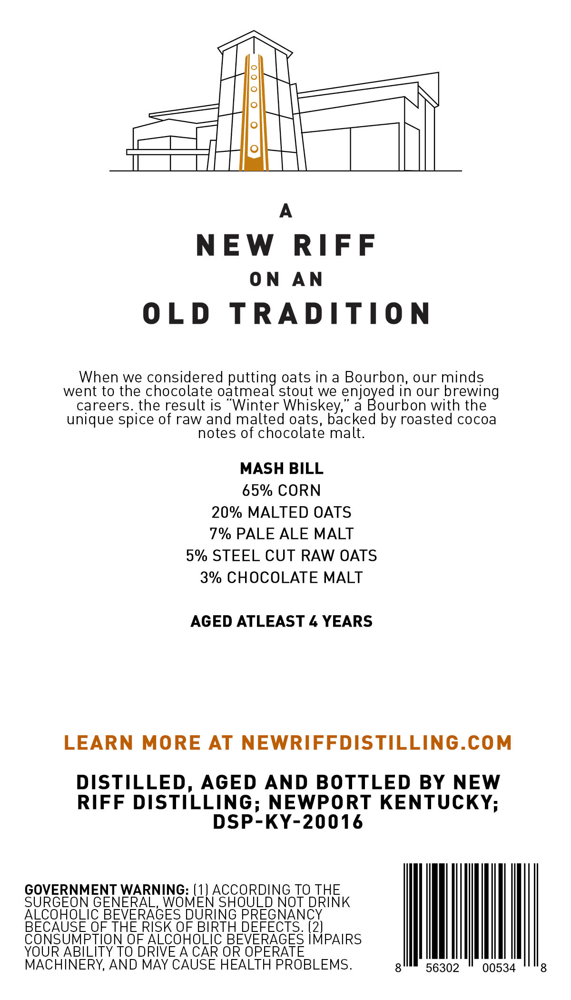
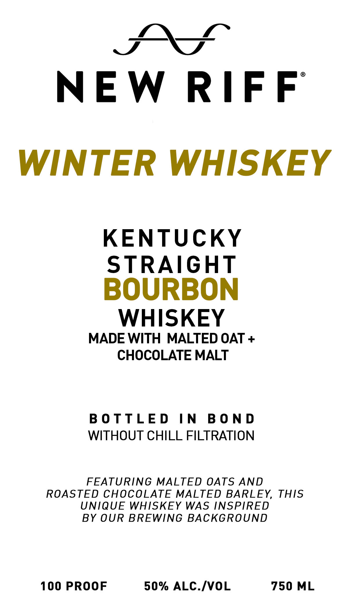

# TTB COLA Label Images - TTBID 20239001000400

**Brand Name:** NEW RIFF

**Fanciful Name:** WINTER WHISKEY

**Issue Date:** 09/16/2020

**Origin Code:** 22

**Product Class/Type:** 101

**Source:** [TTB Public COLA Registry](https://ttbonline.gov/colasonline/viewColaDetails.do?action=publicFormDisplay&ttbid=20239001000400)

## Label Images

### Back Label

### Front Label

## Verified Release Evidence

The front label identifies Winter Whiskey as Kentucky straight bourbon at
100 proof. The back label states an age of at least four years and identifies
New Riff Distilling in Newport, Kentucky.

The [2026 official product page](https://newriffdistilling.com/spirits/new-riff-winter-whiskey/)
confirms the same age, proof, and whiskey type. Historical announcements confirm
the [2020 debut](https://thewhiskeywash.com/bourbon/kentuckys-new-riff-offers-up-a-whiskey-made-from-chocolate-malt/),
[2024 return](https://www.breakingbourbon.com/bourbon-whiskey-press-releases/new-riff-relaunches-winter-whiskey-for-the-holidays),
and [2025 return](https://www.breakingbourbon.com/bourbon-whiskey-press-releases/new-riff-re-releases-winter-whiskey-and-sherry-finish-malted-rye-for-the-holidays).
The index groups these recurring releases in a 2020-2026 range because their
indexed attributes are unchanged. The archived label's mashbill differs from
the 2026 recipe; it documents the historical product, not a verified 2026 label revision.

