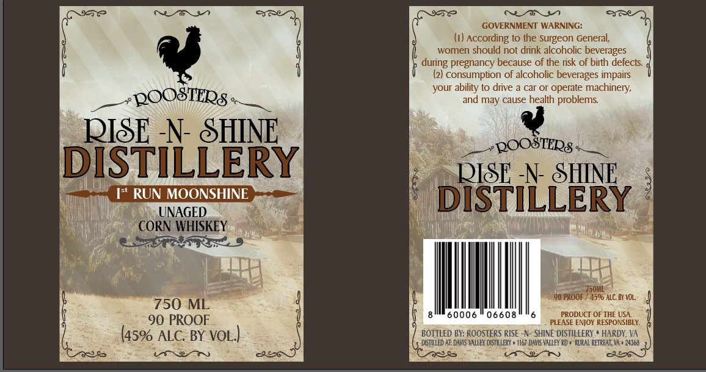

# TTB COLA Label Images - TTBID 21148001000458

**Brand Name:** ROOSTERS RISE -N- SHINE DISTILLERY

**Fanciful Name:** 1ST RUN MOONSHINE

**Issue Date:** 06/07/2021

**Origin Code:** 05

**Product Class/Type:** 143

**Source:** [TTB Public COLA Registry](https://ttbonline.gov/colasonline/viewColaDetails.do?action=publicFormDisplay&ttbid=21148001000458)

## Label Images

### Label 1

## Extracted Label Text

*Text extracted via OCR - may contain errors*

**Detected Proof:** 90

### Label 1

~uY
GOVERNMENT WARNING:
(I) According to the surgeon General;
women should not drink alcoholic beverages
pregnancy because of the risk of birth defects.
(2) consumption of alcoholic beverages impairs
your ability to drive a car or operate machinery;
pOOSTERS-
and may cause health problems
PISE -N SHINE
pOOSTERS =
DISTILLERY
PISE -N SHNE
Ist RUN MOONSHINE
DISTILLERY
UNAGED
CORN WHISKEY
'SomL
90 PROOF
4596 ALC. By VOL;
750 ML
60006
06608
PRODUCT OF THE USA
90 PROOF
PLEASE ENJOY RESPONSIBLY
(45% ALC. BY VOL )
BOTTLED BY: ROOSTERS RISE ~N- SHINE DISTILLERY
HARDY, VA
DLSTILLED AT: DHLIS VaLLeY DISTILLERY + 1167 DAVS ValleY RD , RuRAL RETREAT; VA ' 24368
306
81076
Te
356 =
during-
