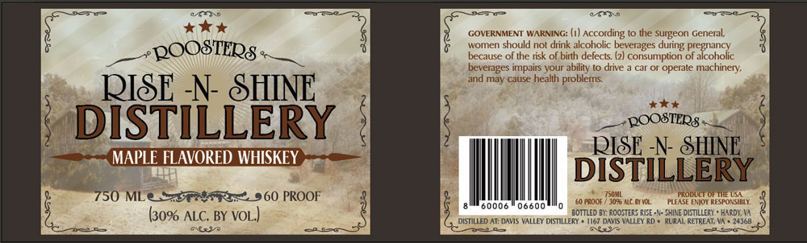

# TTB COLA Label Images - TTBID 21148001000491

**Brand Name:** ROOSTERS RISE -N- SHINE DISTILLERY

**Fanciful Name:** MAPLE

**Issue Date:** 06/03/2021

**Origin Code:** 05

**Product Class/Type:** 149

**Source:** [TTB Public COLA Registry](https://ttbonline.gov/colasonline/viewColaDetails.do?action=publicFormDisplay&ttbid=21148001000491)

## Label Images

### Label 1

## Extracted Label Text

*Text extracted via OCR - may contain errors*

**Detected Proof:** 120

### Label 1

GOVERNMENT WARNING: (I] According
the Surgeon General;
pOOSTERS
women should nol drink alcoholic
beverages duting pregnancy
because of the iisk of birth delects:
consumption of alcoholic
beverages impairs your ability to drive
car 01 operale
machinery:
and mav cause health
problems:
pISE -N SHINE
DISTILLERY
pOOSTERS =
PISE-N SHINE
MAPLE FLAVORED WHISKEY
DISTILLERY
750 MLessz
60 PROOF
punnimmmfsa
PROCF
Ihh
PUEASE ENIOR FESPOuSRLT
6 000G
06600
(30% ALC. BY VOL )
Eomtleo Bi: ROOMIERS RISE
Mhne distilleRY
Hafdi M
DISMLLED AI; DAMS VALLEY DISTLLERY
DAVS VALLEY RD
RLRAL RETREAT; VA
24368.
CV?
G
