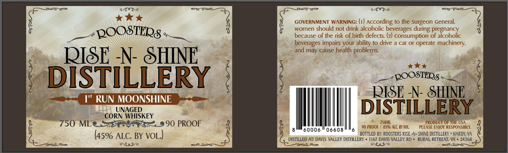

# TTB COLA Label Images - TTBID 21148001000497

**Brand Name:** ROOSTERS RISE -N- SHINE DISTILLERY

**Fanciful Name:** 1ST RUN MOONSHINE

**Issue Date:** 06/07/2021

**Origin Code:** 05

**Product Class/Type:** 143

**Source:** [TTB Public COLA Registry](https://ttbonline.gov/colasonline/viewColaDetails.do?action=publicFormDisplay&ttbid=21148001000497)

## Label Images

### Label 1

## Extracted Label Text

*Text extracted via OCR - may contain errors*

**Detected Proof:** 90

### Label 1

/*3 5
GOVERNMENT WARNING: (1) According to the Surgeon General;
pOOSTERS -
8
women should not drink alcoholic beverages during
ralconoxc
because of the risk of birth defects: (2) consumption of
beverages impairs your ability to drive
car Or operate
machinery;
and may cause health
problems
pISE -N SHINE
DISTILLERY
pOOSTERS
Ist RUN MOONSHINE
DISE -N SHINE
UNAGED
DISTILLERY
CORN WHISKEY
750 MLe
90 PROOF
750ML
PRODUCT OF THE USA_
90 PROOF
4596 ALC. BY VOL
PLEASE ENIOY RESPONSIBLY
60006
06608
l45% ALC. BY VOL )
BOTTLED BY: ROOSTERS RISE -N- SHINE DISTILLERY * HARDY; VA
DISTILLED AT: DAVIS VALLEY DISTILLERY
1167 DAVIS VALLEY RD
RURAL RETREAT; VA * 24368
0 6xo
0Sn
06 2
6€l?
[2
