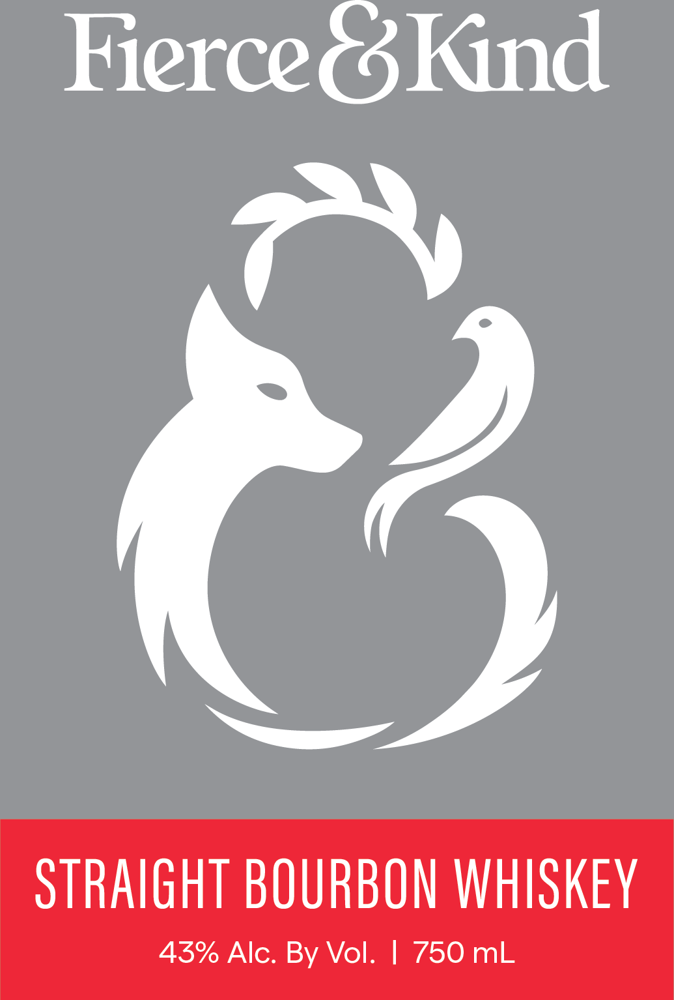
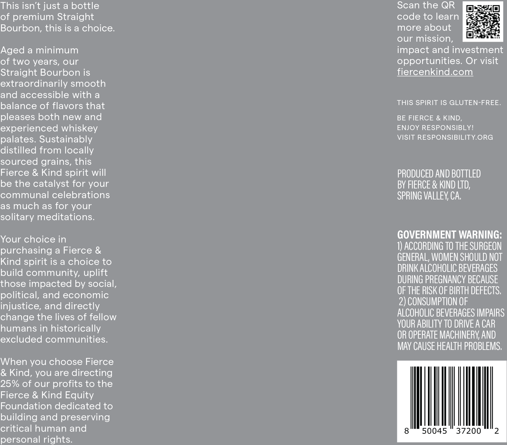

# TTB COLA Label Images - TTBID 22314001000644

**Brand Name:** FIERCE & KIND

**Issue Date:** 11/18/2022

**Product Class/Type:** 101

**Source:** [TTB Public COLA Registry](https://ttbonline.gov/colasonline/viewColaDetails.do?action=publicFormDisplay&ttbid=22314001000644)

## Label Images

### Front Label

### Back Label

## Verified Label Details

The front label identifies straight bourbon whiskey at 43% ABV (86 proof).
The back label states a minimum age of two years.
The approval date is not a release date: the brand's official history dates
its inaugural bourbon launch to 2023.
