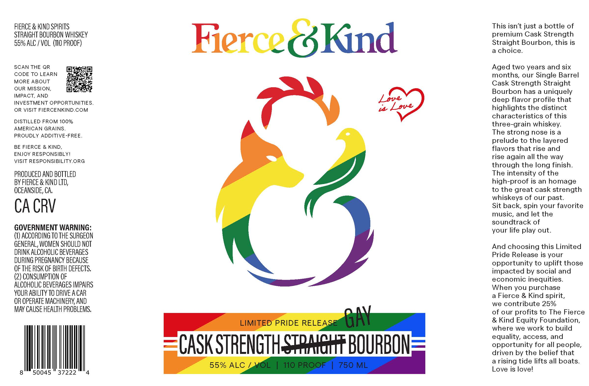

# TTB COLA Label Images - TTBID 24142001001138

**Brand Name:** FIERCE & KIND

**Issue Date:** 05/26/2024

**Product Class/Type:** 101

**Source:** [TTB Public COLA Registry](https://ttbonline.gov/colasonline/viewColaDetails.do?action=publicFormDisplay&ttbid=24142001001138)

## Label Images

### Label 1

## Verified Label Details

The Limited Pride Release label identifies cask strength straight bourbon
at 55% ABV (110 proof), aged two years and six months.
The [official June 2024 announcement](https://fiercenkind.com/blogs/fierce-and-kind-news/pride-business-highlights-fierce-kind-pride-collection)
confirms the release.
