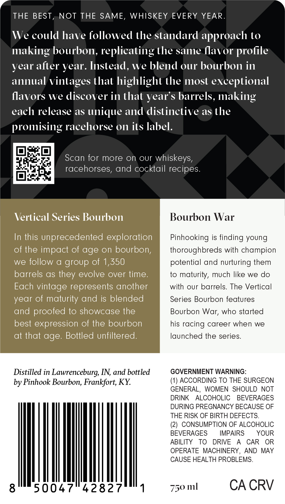
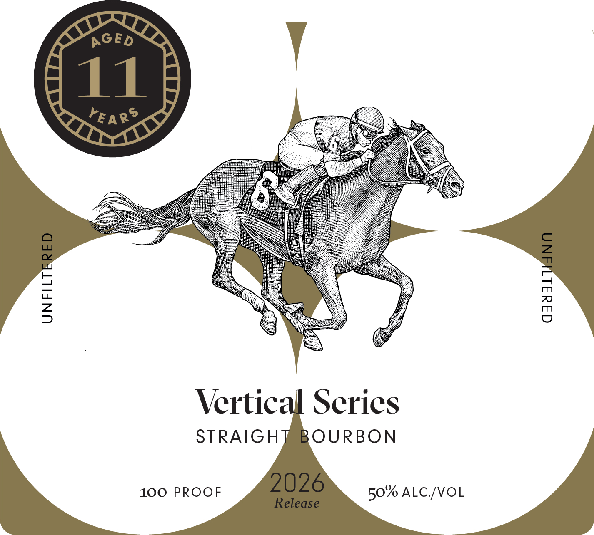

# TTB COLA Label Images - TTBID 25323001000448

**Brand Name:** PINHOOK

**Issue Date:** 11/25/2025

**Origin Code:** 22

**Product Class/Type:** 101

**Source:** [TTB Public COLA Registry](https://ttbonline.gov/colasonline/viewColaDetails.do?action=publicFormDisplay&ttbid=25323001000448)

## Label Images

### Back Label

### Front Label

## Verified Release Evidence

The front label identifies the 2026 Vertical Series Straight Bourbon release
aged 11 years. The back label names Bourbon War and identifies distillation in
Lawrenceburg, Indiana, with bottling by Pinhook Bourbon in Frankfort, Kentucky.

The approved label artwork displays 100 proof. The
[official release page](https://pinhookbourbon.com/products/vertical-series-bourbon-11-year)
specifies 114.4 proof for the released bourbon, which is the value used in the
index. This COLA identifies the product and vintage; the official product page
is the evidence for its released strength.

