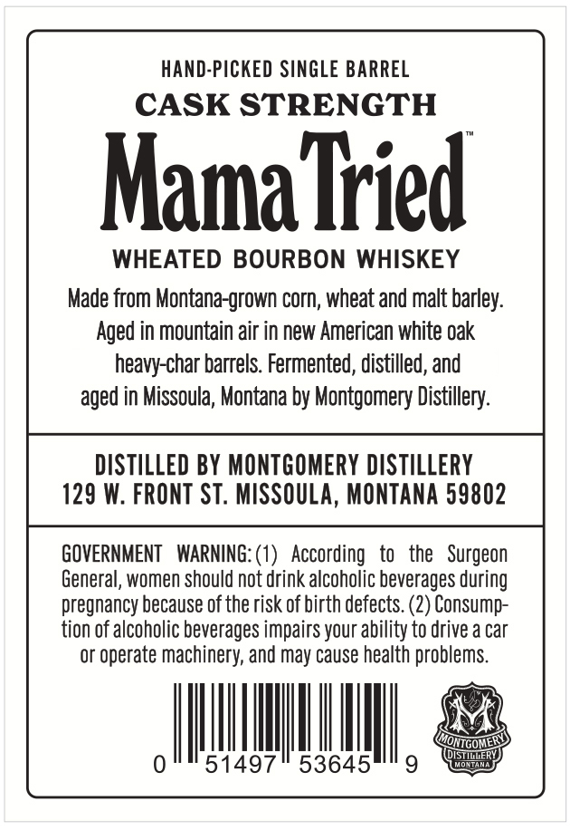
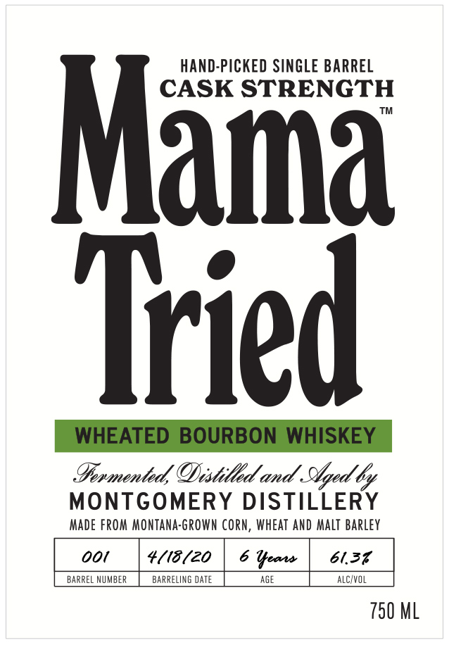

# TTB COLA Label Images - TTBID 26237001000635

**Brand Name:** MAMA TRIED

**Fanciful Name:** HAND-PICKED SINGLE BARREL

**Issue Date:** 11/09/2026

**Origin Code:** 30

**Product Class/Type:** 101

**Source:** [TTB Public COLA Registry](https://ttbonline.gov/colasonline/viewColaDetails.do?action=publicFormDisplay&ttbid=26237001000635)

## Label Images

### Back Label

### Front Label

## Extracted Label Text

*Text extracted via OCR - may contain errors*

### Back Label

HAND-PICKED SINGLE BARREL
CASK STRENGTH
Mama Tied
WHEATED BOURBON WHISKEY
Made from Montana-grown corn, wheat and malt barley:
Aged in mountain air in new American white oak
heavy-char barrels. Fermented; distilled, and
aged in Missoula; Montana by Montgomery Distillery:
DISTILLED BY MONTGOMERY DISTILLERY
129 W: FRONT ST. MISSOULA, MONTANA 59802
GOVERNMENT
WARNING: (1)   According
to
the   Surgeon
General, women should not drink alcoholic beverages during
pregnancy because of the risk of birth defects. (2) Consump-
tion Of alcoholic beverages impairs your ability to drive a car
Or
'operate machinery; and
cause health problems.
ONIGONER
ISTIQDER
51497
53645'
9
Monton
may

### Front Label

HAND-PICKED SINGLE BARREL
STRENGTH
Mama
Tried
WHEATED BOURBON WHISKEY
Inmented, ODistilld and Stged 6
MONTGOMERY DISTILLERY
MAde FROM MonTana-Grown corn, WHEAT AND
barley
ooi
4(18 (20
Ueaws
61.37
BARREL NUMBER
BARRELING daTe
AGE
alcivol
750 ML
Malt
