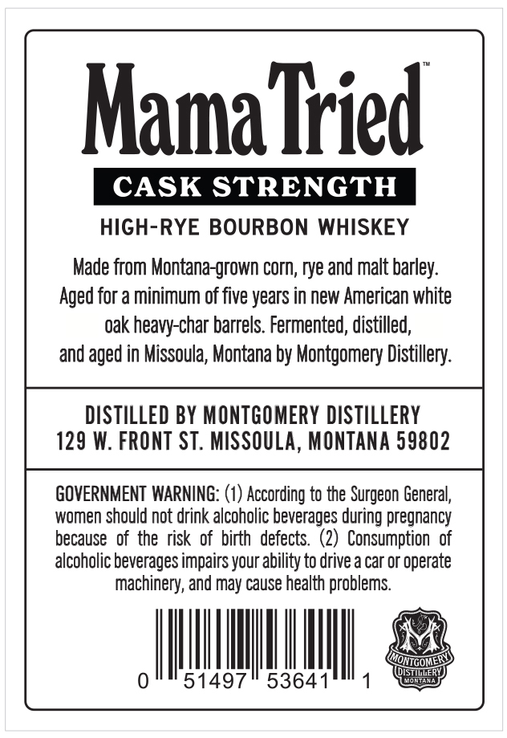
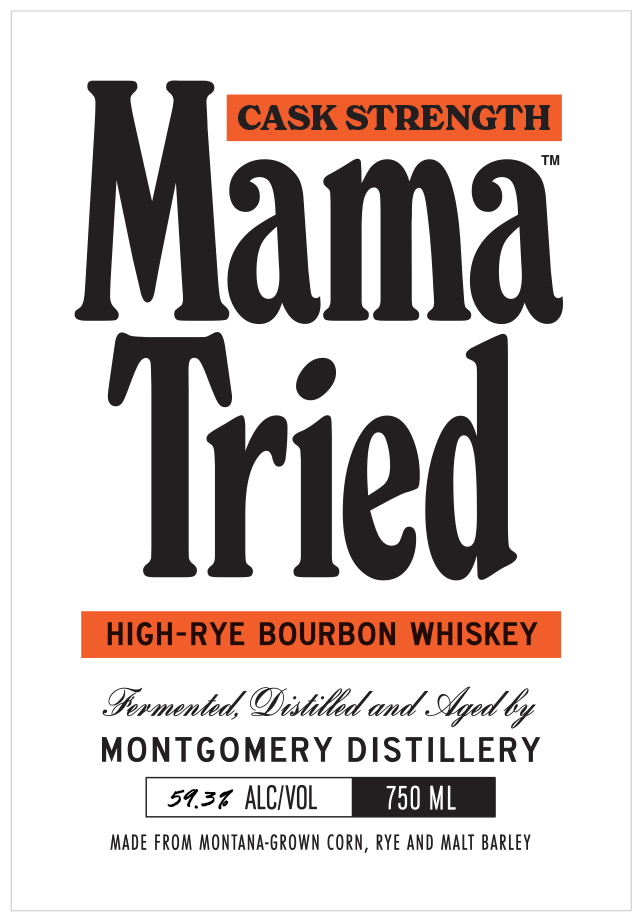

# TTB COLA Label Images - TTBID 26237001000642

**Brand Name:** MAMA TRIED

**Fanciful Name:** CASK STRENGTH

**Issue Date:** 11/09/2026

**Origin Code:** 30

**Product Class/Type:** 141

**Source:** [TTB Public COLA Registry](https://ttbonline.gov/colasonline/viewColaDetails.do?action=publicFormDisplay&ttbid=26237001000642)

## Label Images

### Back Label

### Front Label

## Extracted Label Text

*Text extracted via OCR - may contain errors*

### Back Label

Mama Tried
CASK STRENGTH
HIGH-RYE BOURBON WHISKEY
Made from Montana-grown corn; rye and malt barley:
Aged for a minimum of five years in new American white
oak heavy-char barrels. Fermented, distilled,
and aged in Missoula, Montana by Montgomery Distillery:
DISTILLED BY MONTGOMERY DISTILLERY
129 W: FRONT ST . MISSOULA, MONTANA 59802
GOVERNMENT WARNING: (1) According to the Surgeon General;,
women should not drink alcoholic beverages during pregnancy
because  of the risk  of  birth   defects   (2)   Consumption   of
alcoholic beverages impairs your ability to drive a car or operate
machinery; and may cause health problems
MONIGOME
DISTIGLER
51497
53641
Mdmte

### Front Label

CASK STRENGTH
Mama
Tried
HIGH-RYE BOURBON
WHISKEY
Iormented/ODistilld and Stged &
MONTGOMERY DISTILLERY
54.37 ALCVOL
750 ML
Made FRom MontAna-GRown Corn, rye ANd Malt Barley
