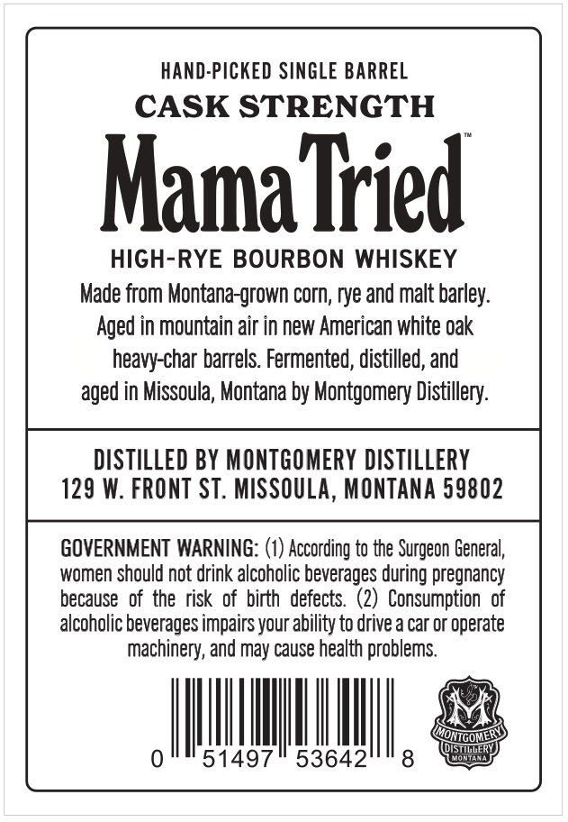
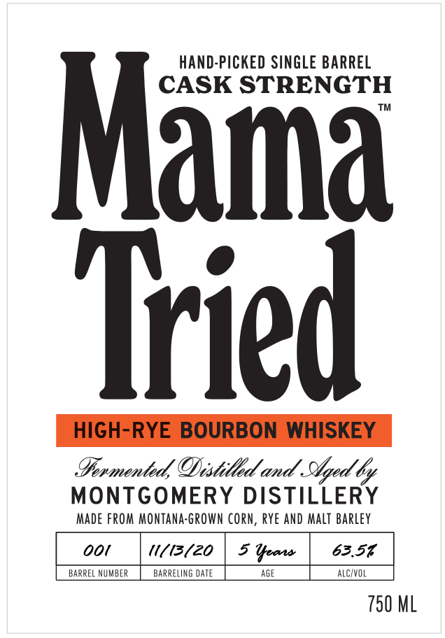

# TTB COLA Label Images - TTBID 26237001000644

**Brand Name:** MAMA TRIED

**Fanciful Name:** HAND-PICKED SINGLE BARREL

**Issue Date:** 11/09/2026

**Origin Code:** 30

**Product Class/Type:** 141

**Source:** [TTB Public COLA Registry](https://ttbonline.gov/colasonline/viewColaDetails.do?action=publicFormDisplay&ttbid=26237001000644)

## Label Images

### Back Label

### Front Label

## Extracted Label Text

*Text extracted via OCR - may contain errors*

**Detected Age:** 5 Years

### Back Label

HAND-PICKED SINGLE BARREL
CASK STRENGTH
Mama Tied
HIGH-RYE BOURBON WHISKEY
Made from Montana-grown corn; rye and malt barley:
Aged in mountain air in new American white oak
heavy-char barrels. Fermented; distilled, and
aged in Missoula, Montana by Montgomery Distillery:
DISTILLED BY MONTGOMERY DISTILLERY
129 W. FRONT ST. MISSOULA, MONTANa 59802
GOVERNMENT WARNING: (1) According to the Surgeon General,
women should not drink alcoholic beverages during pregnancy
because  of the  risk   of  birth   defects.
Consumption   of
alcoholic beverages impairs your ability to drive a car or operate
machinery, and may cause health problems
ONTGOMEC
Msttet
51497
53642
8
aca

### Front Label

HAND-PICKED SINGLE BARREL
STRENGTH
Mama
Tried
HIGH-RYE BOURBON WHISKEY
IFovmentedODistilld and Staed 6o
MONTGOMERY DISTILLERY
Made FrOM MONTAna-Grown Corn, Rye AND Malt  Barley
ooi
1(i3(zo
5 Year
63.51
BARREL MUMBER
BARRELIXG OATE
AGE
ALCYVOL
750 ML
