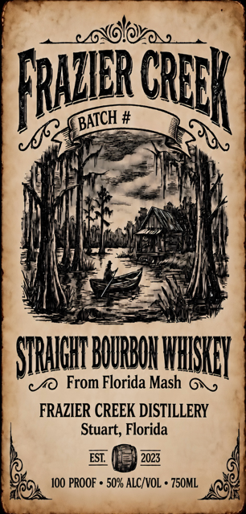
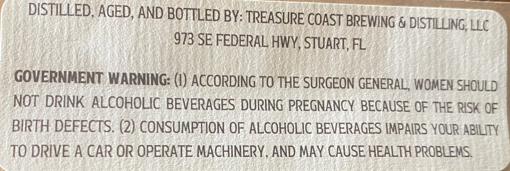

# TTB COLA Label Images - TTBID 26238001000323

**Brand Name:** FRAZIER CREEK

**Issue Date:** 11/02/2026

**Origin Code:** 16

**Product Class/Type:** 101

**Source:** [TTB Public COLA Registry](https://ttbonline.gov/colasonline/viewColaDetails.do?action=publicFormDisplay&ttbid=26238001000323)

## Label Images

### Label 1

### Label 2

## Extracted Label Text

*Text extracted via OCR - may contain errors*

**Detected Proof:** 100

### Label 1

fWoa
FRIIRGRDK
SIRHHBHRBMKHHISYIY
From Florida Mash
FRAZIER CREEK DISTILLERY
Stuart; Florida
2023
100 PROOF + 507 ALC VOL + 75OML
BATCH

### Label 2

DISTILLED, AGED, AND BOTTLED BY: TREASURE COAST BREWING & DISTILLING
LLC
973 SE FEDERAL HWY, STUART, FL
GOVERNMENT WARNING: (I) ACCORDING TO THE SURGEON GENERAL, WOMEN SHOULD
NOT DRINK ALCOHOLIC BEVERAGES DURING PREGNANCY BECAUSE OF THE RISK QF
BIRTH DEFECTS: (2) CONSUMPTION OF ALCOHOLIC BEVERAGES IMPAIRS YOUR ABILITY
TO DRIVE A CAR OR OPERATE MACHINERY, AND MAY CAUSE HEALTH PROBLEMS
