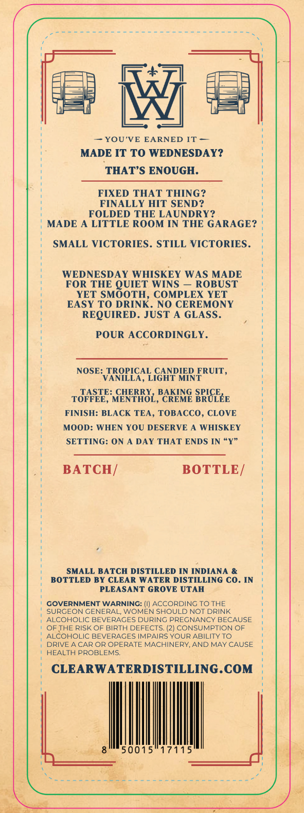
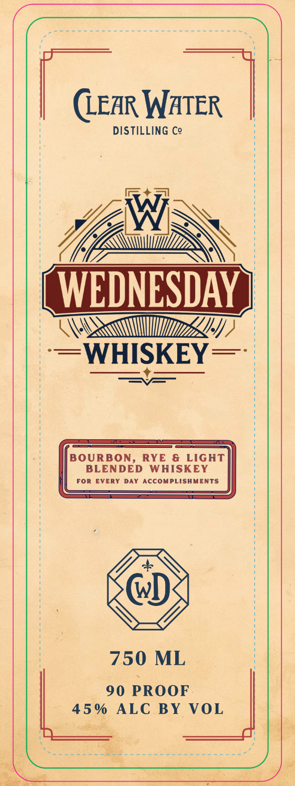

# TTB COLA Label Images - TTBID 26238001000548

**Brand Name:** WEDNESDAY WHISKEY

**Issue Date:** 10/13/2026

**Origin Code:** 45

**Product Class/Type:** 140

**Source:** [TTB Public COLA Registry](https://ttbonline.gov/colasonline/viewColaDetails.do?action=publicFormDisplay&ttbid=26238001000548)

## Label Images

### Back Label

### Front Label

## Extracted Label Text

*Text extracted via OCR - may contain errors*

**Detected Proof:** 90

### Back Label

M
YOU'VE EARNED IT
MADE IT TO WEDNESDAY?
THAT'S ENOUGH.
FIXED THAT THING ?
FINALLY HIT SEND?
FOLDED THE LAUNDRY?
MADE
LITTLE ROOM IN THE GARAGE?
SMALL VICTORIES . STILL VICTORIES
WEDNESDAY WHISKEY WAS MADE
FOR THE
WINS
ROBUST
YET
COMPLEX YET
EASY TO
SMBQNR.
NO CEREMONY
REQUIRED . JUST A GLASS.
POUR ACCORDINGLY.
NOSE: TROPICAL
GHNPHRFRUIT
VANILLA ,
MINT
TOHSE:
NHFHOz;E
BEKEMG SRGEEE
FINISH: BLACK TEA, TOBACCO, CLOVE
MOOD: WHEN YOU DESERVE A WHISKEY
SETTING: ON
DAY THAT ENDS IN "Y"
BATCH/
BOTTLE /
SMALL BATCH DISTILLED IN INDIANA &
BOTTLED BY CLEAR WATER DISTILLING CO. IN
PLEASANT GROVE UTAH
GOVERNMENT WARNING: (I) ACCORDING TO THE
SURGEON GENERAL; WOMEN SHOULD NOT DRINK
ALCOHOLIC BEVERAGES DURING PREGNANCY BECAUSE
OF THE RISK OF BIRTH DEFECTS. (2) CONSUMPTION OF
ALCOHOLIC BEVERAGES IMPAIRS YOUR ABILITY T0
DRIVE A CAR OR OPERATE MACHINERY, AND MAY CAUSE
HEALTH PROBLEMS:
CLEARWATERDISTILLING.COM
50015
17115
QUIET

### Front Label

(LEAR WATER
DISTILLING Cg
W
WEDNESDAY
WHISKEY
BOURBON,
RYE & LIGhT
BLENDED
WHISKEY
FOR
EVERY DaY
ACCOMPLISHMENTS
750 ML
90 PROOF
4 5 %
ALC
BY
VOL
