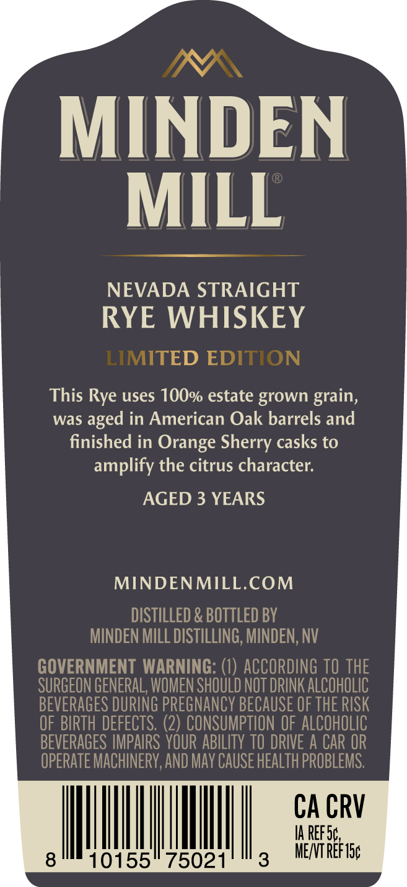
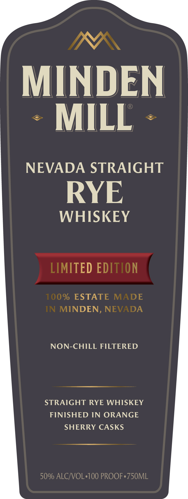

# TTB COLA Label Images - TTBID 26239001000849

**Brand Name:** MINDEN MILL

**Fanciful Name:** LIMITED EDITION FINISHED IN ORANGE SHERRY CASKS

**Issue Date:** 10/14/2026

**Origin Code:** 32

**Product Class/Type:** 102

**Source:** [TTB Public COLA Registry](https://ttbonline.gov/colasonline/viewColaDetails.do?action=publicFormDisplay&ttbid=26239001000849)

## Label Images

### Back Label

### Front Label

### Label 3

## Extracted Label Text

*Text extracted via OCR - may contain errors*

*1 image(s) excluded: text did not meet readability threshold*

**Detected Proof:** 100
**Detected Age:** 3 Years

### Back Label

MINDEN
MILL
NEVADA STRAIGHT
RYE WHISKEY
LIMITED EDITION
This Rye uses 1OO% estate grown grain,
was
in American Oak barrels and
finished in Orange Sherry casks to
amplify the citrus character:
AGED 3 YEARS
MINDENMILL.COM
DISTILLED & BOTTLED BY
MINDEN MILL DISTILLING, MINDEN;, NV
GOVERNMENT WARNING: (1) ACCORDING TO THE
SURGEON GENERAL, WOMEN SHOULD NOT DRINK AlCOhOLIC
BEVERAGES DURING PREGNANCY BECAUSE OF THE RISK
OF BIRTH DEFECTS; (2) CONSUMPTION OF ALCOHOLIC
BEVERAGES IMPAIRS YOUR ABILITY TO DRIVE A CAR OR
OPERATE MACHINERV,AND May CAUSe HEALTh PROBLEMS:
CA CRV
IA RefSc
8
10155
75021
3
MENT Ref1sc
aged

### Front Label

MINDEN
MILL
NEVADA STRAIGHT
RYE
WHISKEY
LIMITED EDITION
100% ESTATE
MADE
IN MINDEN, NEVADA
NON-CHILL FILTERED
STRAIGHT RYE WHISKEY
FINISHED IN ORANGE
SHERRY CASKS
50% ALCJVOL'100 PROOF,750ML
