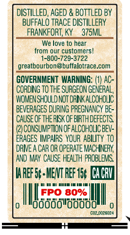
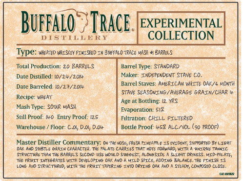

# TTB COLA Label Images - TTBID 26245001000384

**Brand Name:** BUFFALO TRACE EXPERIMENTAL COLLECTION

**Issue Date:** 10/19/2026

**Origin Code:** 22

**Product Class/Type:** 140

**Source:** [TTB Public COLA Registry](https://ttbonline.gov/colasonline/viewColaDetails.do?action=publicFormDisplay&ttbid=26245001000384)

## Label Images

### Back Label

### Front Label

## Extracted Label Text

*Text extracted via OCR - may contain errors*

### Back Label

DISTILLED, AGED & BOTTLED BY
BUFFALO TRACE DISTILLERY
FRANKFORT, KY
375ML
We love to hear
from our customers
-800-729-3722
greatbourbon@buffalotrace,com
GOVERNMENT  WARNING: (1) AC-
CORDING TO THE SURGEON GENERAL,
WOMENSHOULD NOT DRNK ALCOHOLIC
BEVERAGES DURING PREGNANCY BE-
CAUSE OFTHERISK OFBIRTHDEFECTS
CONSUMPTION OF AlCOHOLIC BEV:
ERAGES IMPAIRS  YOUR  ABILITY to
dRIE A CAR OR OpeRATE MACHNERY
AND MAY CAUSE HEALTH  PROBLEMS
HaREf5+MENT REF 15, CACbV
FPO 80%
loddddldobdd
C02.0026124

### Front Label

Buffalo
TRacE.
EXPERIMENTAL
DISTILLE RY
COLLECTION
Type: wkekTed NKI S<ey FINISHeD IW Buffalo Trace MAS!
Barre$
Total Production: 20 BARRZLS
Barrel Iype:
STanDar)
Date Distilled; [0/21/2014
Maker: InDePENDENT STAVE CO_
Barrcl Stavcs; AvERICAU WITe OAK/G MontH
Datc Barrcled: 10/27/20lF
STAve SEASCNING / AvERASe SRAIN/ChaR
Recipe: wkert
Age at Bottling:
YRS
Mash Type
SOUR MASH
Evaporaltior; 5I?
Still Proof: ID
Prool: 125
Filtration: CHILL FILTERED
Warehouse
Floor- €.0, D.ol; Dolr
Proof: [+5? ALCNCL
90 {roof)
Master Distiller Commentary: On~Ye *OS FRESH FI NEATLE
JNIDENT {1ippurted % LIGHT
OAk ANd StBT + 6R410 CiarALTeR Tle PAL At CarrzLs THAT ini FOrwARD
Ni TI
Wnale
TANN C
SRRUCTURc THAH TH4l BARRiL _ StCoip MSL NuD Suggest, ALONGSTOC
SLIGHT Dryness  MID PALATV
7lle FRUTT InebratES
Ceve_OPIVS Oak Ad
MIlD SFICe; AdD_NS 3alAnce: 7he FIVISH IS
LoNS ^ 0 Siriic7 Mred; WI7H 7he FRUIT TAPErI 6 IMd DRYI 6 Dak And
S7erd , CoRosed Cluse_
Orurfarz
Entny
Boutle
