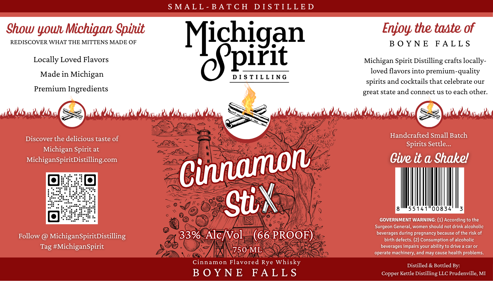

# TTB COLA Label Images - TTBID 26245001000600

**Brand Name:** MICHIGAN SPIRIT DISTILLING

**Fanciful Name:** CINNAMON STIX

**Issue Date:** 10/09/2026

**Origin Code:** 06

**Product Class/Type:** 149

**Source:** [TTB Public COLA Registry](https://ttbonline.gov/colasonline/viewColaDetails.do?action=publicFormDisplay&ttbid=26245001000600)

## Label Images

### Label 1

### Label 2

## Extracted Label Text

*Text extracted via OCR - may contain errors*

**Detected Proof:** 66

### Label 1

Handcrafted Small

Settle.

Gags

Suk

ROVAE

Shakell

—S

### Label 2

S MA L L - BATC H
D I S TILL E D
Show
Michigan Spinit
Enjoy the taste of
REDISCOVER WHAT THE MITTENS MADE OF
B 0 Y N E
FALL S
Locally Loved Flavors
Kicbigan
Michigan Spirit Distilling crafts locally-
Made in Michigan
D  S TIL L [ NG
loved
into
premium-quality
spirits and cocktails that celebrate our
Premium Ingredients
great state and connect uS to each other
"Suls "aSd
Vnls  SKianls  o6aKoil
A(wi
OaSson"s Oosa6
0SaKowil
Handcrafted Small Batch
Discover the delicious taste of
Spirits Settle _
Michigan Spirit at
MichiganSpiritDistilling com
Give it a Shakel
55141
00834
GOVERNMENT WARNING: (1) According to the
Surgeon General, women should not drink alcoholic
Follow
MichiganSpiritDistilling
33%
AlcNVol
(66 PROOF)
beverages during pregnancy because of the risk of
birth defects: (2) Consumption of alcoholic
#MichiganSpirit
beverages impairs your ability to drive a car or
750 ML
operate machinery; and may cause health problems_
Cinnamon Flavored Rye Whisky
Distilled & Bottled By:
B 0 Y N E
FAL L S
Copper Kettle Distilling LLC Prudenville, MI
YOU
flavors
@KiilA
Cinamon
StiX
Tag
