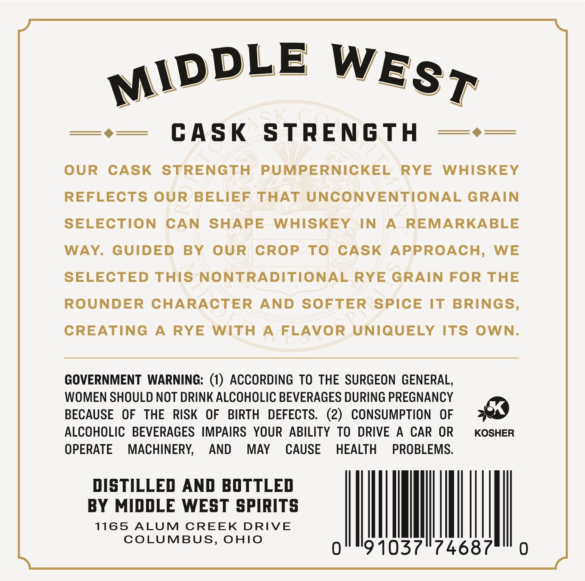
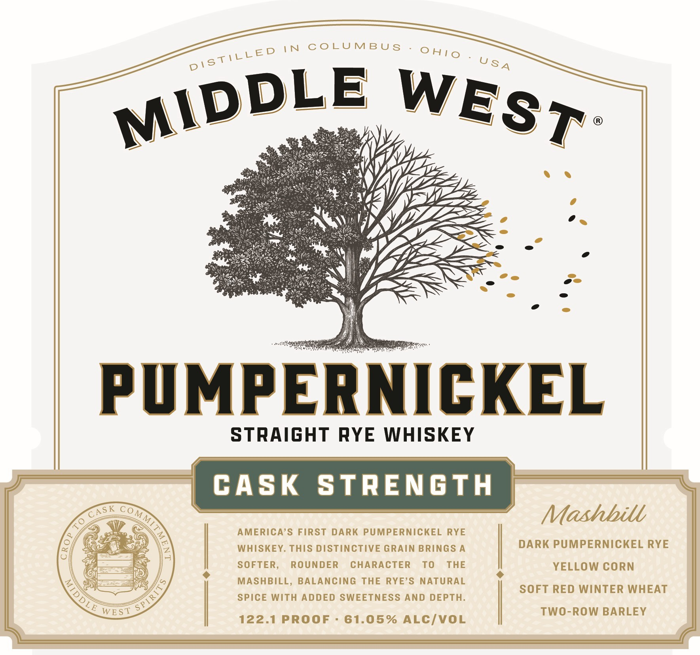

# TTB COLA Label Images - TTBID 26249001000014

**Brand Name:** MIDDLE WEST

**Issue Date:** 10/20/2026

**Origin Code:** 09

**Product Class/Type:** 102

**Source:** [TTB Public COLA Registry](https://ttbonline.gov/colasonline/viewColaDetails.do?action=publicFormDisplay&ttbid=26249001000014)

## Label Images

### Back Label

### Front Label

### Label 3

## Extracted Label Text

*Text extracted via OCR - may contain errors*

*1 image(s) excluded: text did not meet readability threshold*

**Detected Proof:** 122.1

### Back Label

CASK
STRENGTH
OUR
CASK
STRENGTH
PUMPERNICKEL
RYE
WHISKEY
REFLECTS OUR BELIEF THAT UNCONVENTIONAL GRAIN
SELECTION
CAN
SHAPE
WHISKEY
IN
A
REMARKABLE
WAY
GUIDED
BY
OUR
CROP
To
CASK APPROACH,
WE
SELECTED THIS NONTRADITIONAL RYE GRAIN FOR THE
ROUNDER CHARACTER
AND
SOFTER SPICE
IT BRINGS,
CREATING
A
RYE
WITH
A
FLAVOR
UNIQUELY ITS OWN.
GOVERNMENT WARNING: (1) ACCORDING TO THE SURGEON GENERAL,
WOMEN SHOULD NOT DRINK ALCOHOLIC BEVERAGES DURING PREGNANCY
BECAUSE
OF
THE  RISK
OF
BIRTH
DEFECTS.    (2)
CONSUMPTION
OF
ALCOHOLIC   BEVERAGES IMPAIRS YOUR ABILITY TO DRIVE
A
CAR
OR
KOSHER
OPERATE
MACHINERY;
AND
MAY
CAUSE
HEALTH
PROBLEMS:
DISTILLED AND BOTTLED
BY MIDDLE WEST SPIRITS
1165
ALUM
CREEK
DRIVE
COLUMBUS, OHIO
0
91037174687
MIDDLE
WEST

### Front Label

TN CoLUMBU $
PMPERNICKEL
STRAIGHT
RYE
WHISKEY
CASK
StrEnGTH
M
Mashbill
AMERICA'S FIRST
DARK PUMPERNICKEL
RYE
WHISKEY. THIS DISTINCTIVE GRAIN BRINGS A
DARK PUMPERNICKEL RYE
SOFTER,
ROUNDER
CHARACTER
To
THE
YELLOW CORN
MASHBILL, BALANCING THE
RYE'S
NATURAL
SOFT RED WINTER WHEAT
SPIcE With ADDED SWEETNESS AND
DEPTH.
WE ST
TWO-ROW BARLEY
122.1 PROOF
61.05% ALCIVOL
DI STICCED
0 HI0
U SA
MIDDLE
WEST
CAS K
C0_
S PTRI"
DLE
