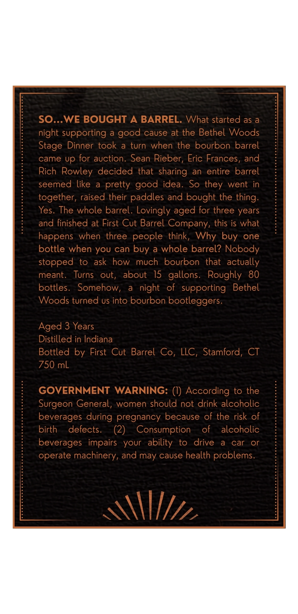
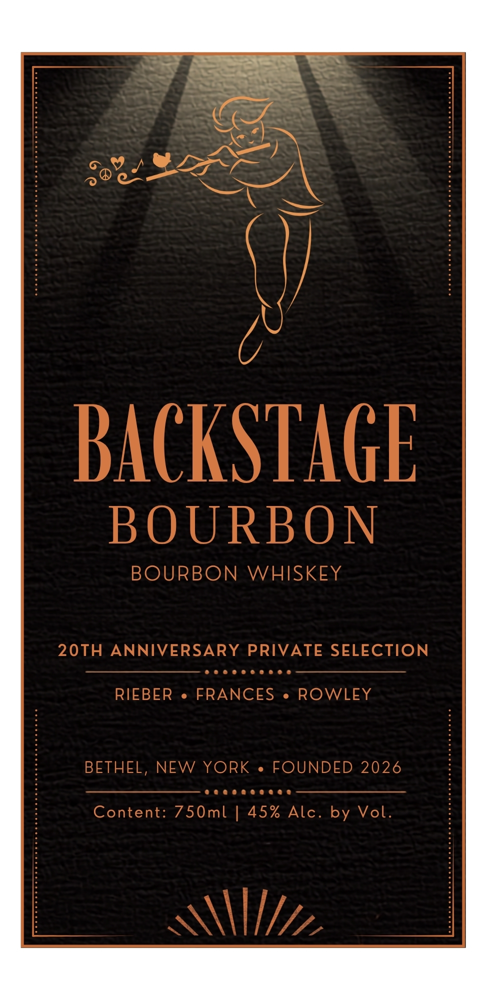

# TTB COLA Label Images - TTBID 26251001000320

**Brand Name:** BACKSTAGE BOURBON

**Issue Date:** 10/13/2026

**Origin Code:** 14

**Product Class/Type:** 141

**Source:** [TTB Public COLA Registry](https://ttbonline.gov/colasonline/viewColaDetails.do?action=publicFormDisplay&ttbid=26251001000320)

## Label Images

### Back Label

### Front Label

## Extracted Label Text

*Text extracted via OCR - may contain errors*

**Detected Proof:** 90
**Detected Age:** 3 Years

### Back Label

SO.-
WE BOUGHT
A
BARREL. What started as a
night supporting
a
cause at the Bethel Woods
Stage Dinner took
a
turn
when the bourbon barrel
came up for auction. Sean Rieber, Eric Frances, and
Rich Rowley decided that
an
entire barrel
seemed like
a
pretty
idea.
So
went in
together, raised their paddles and bought the
Yes. The whole barrel. Lovingly
for three years
and finished at First Cut Barrel Company, this is what
happens
when three people think,
Why
one
bottle when YoU can
a
whole barrel? Nobody
stopped
to
ask
how
much
bourbon  that
actually
meant
Turns
out,
about
15   gallons.
Roughly
80
bottles.
Somehow,
a
night
of
supporting
Bethel
Woods turned us into bourbon bootleggers.
Aged 3 Years
Distilled in Indiana
Bottled by First Cut Barrel
LLC , Stamford,
CT
750 mL
GOVERNMENT
WARNING: (I) According to the
Surgeon General, women should not drink alcoholic
beverages during pregnancy because of the risk of
birth
defects.
(2)
Consumption
of
alcoholic
beverages   impairs
your   ability
to
drive
a
car
or
operate machinery, and may cause health problems.
good
sharing
good
they
thing:
aged
buy
buy
Co,

### Front Label

24
BACKSTaGE
BOURBON
BOURBON
WHISKEY
20TH
ANNIVERSARY
PRIVATE SELECTION
RIEBER
FRANCES
ROWLEY
BETHEL, NEW YORK
FOUNDED 2026
Content: 750ml
45%
Alc _
by Vol.
