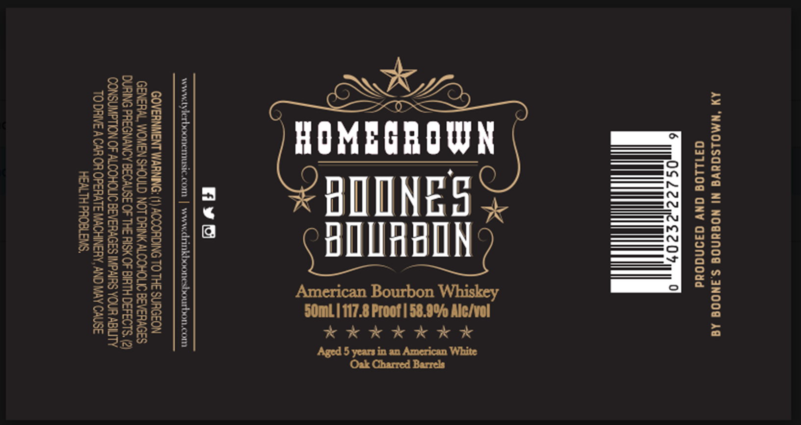

# TTB COLA Label Images - TTBID 26252001000307

**Brand Name:** BOONE'S BOURBON

**Issue Date:** 10/13/2026

**Origin Code:** 22

**Product Class/Type:** 141

**Source:** [TTB Public COLA Registry](https://ttbonline.gov/colasonline/viewColaDetails.do?action=publicFormDisplay&ttbid=26252001000307)

## Label Images

### Label 1

## Extracted Label Text

*Text extracted via OCR - may contain errors*

### Label 1

AM ‘NMOLSGUVG NI NOGUNOG S.3NOOG AG
371108 GNV G39NdG0dd

2

*K

= x
N 5 a EE x i
\\) xe =e £2 x]
= = = / *« a
AN wa | ta SE x:
A\S| = =H pax i
<s| Cem \isxi
eK a
fiyvys
www.tylerboonemusic.com | www.drinkboonesbourbon.com

GOVERNMENT WARNING: (1) ACCORDING TO THE SURGEON
GENERAL, WOMEN SHOULD NOT DRINK ALCOHOLIC BEVERAGES
DURING PREGNANCY BECAUSE OF THE RISK OF BIRTH DEFECTS. (2)
CONSUMPTION OF ALCOHOLIC BEVERAGES IMPAIRS YOUR ABILITY
TO DRIVE ACAR OR OPERATE MACHINERY, AND MAY CAUSE
HEALTH PROBLEMS,
