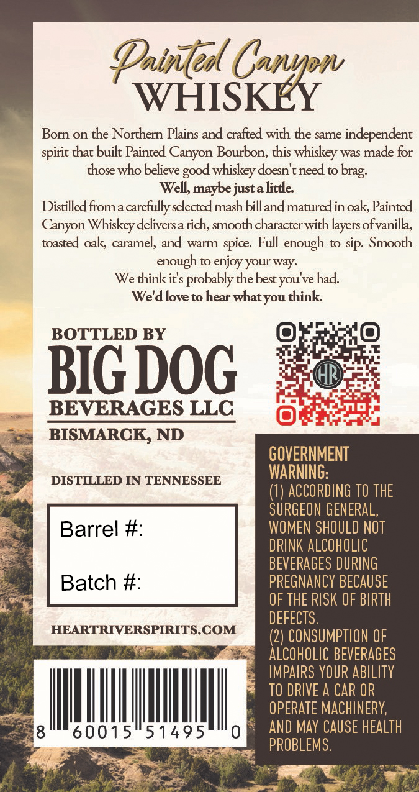
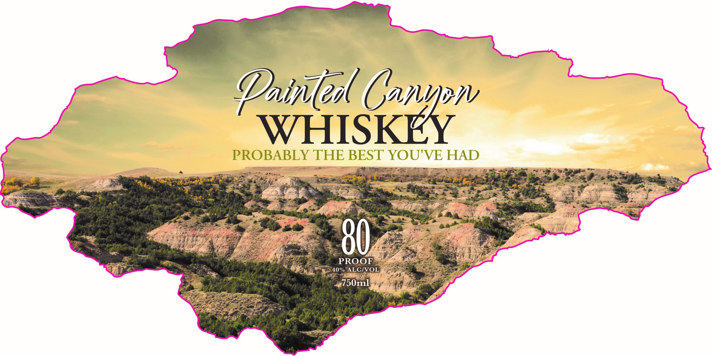

# TTB COLA Label Images - TTBID 26252001000583

**Brand Name:** PAINTED CANYON

**Issue Date:** 10/16/2026

**Origin Code:** 36

**Product Class/Type:** 140

**Source:** [TTB Public COLA Registry](https://ttbonline.gov/colasonline/viewColaDetails.do?action=publicFormDisplay&ttbid=26252001000583)

## Label Images

### Back Label

### Label 1

## Extracted Label Text

*Text extracted via OCR - may contain errors*

*1 image(s) excluded: text did not meet readability threshold*

### Back Label

Datledl Canpw
WHISKEY
Born on the Northern Plains and crafted with the same independent
spirit that built Painted
Bourbon, this whiskey was made for
those who believe
whiskey doesn't need to
Well, maybe justalittle
Distilled froma carefully selected mash billand maturedin oak; Painted
Canyon Whiskey delivers =
rch, smooth characterwith layers ofvanilla,
toasted oak caramel, and warm spice: Full enough to sip. Smooth
enough to
your way:
We think its probably the best you've had
We'dlove to hear whatyou think
BOTTLED BY
BIG DOG
BEVERAGES LLC
BISMARCK, ND
GOVERNMENT
DISTILLED IN TENNESSEE
WARNING:
(1) ACCORDING TO THE
SURGEON GENERAL,
Barrel #:
WOMEN SHOULD NOT
DRINK ALCOHOLIC
BEVERAGES DURING
Batch #:
PREGNANCY BECAUSE
OF THE RISK OF BIPTH
DEFECTS.
HEARTRIVERSPIRITS COM
(2) CONSUMPTION OF
ALCOHOLIC BEVERAGES
IMPAIRS YOUR ABILITY
TO DRIVE A CAR OR
OPERATE MACHINERY;
60015
51495
0
AND May CAUSE HEALTH
PROBLEMS.
Canyon
good
brag:
enjoy
