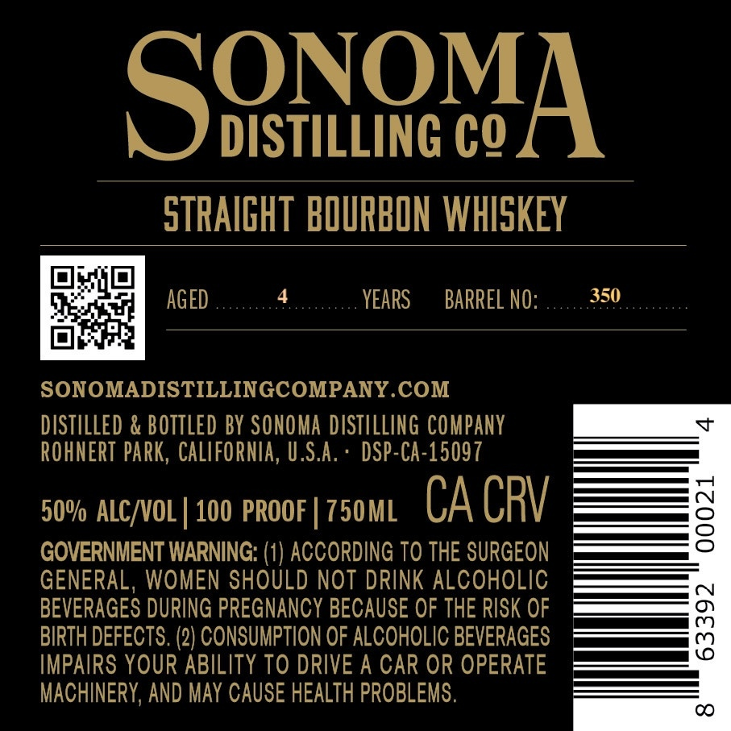

# TTB COLA Label Images - TTBID 26253001000293

**Brand Name:** SONOMA DISTILLING COMPANY

**Issue Date:** 10/14/2026

**Origin Code:** 01

**Product Class/Type:** 101

**Source:** [TTB Public COLA Registry](https://ttbonline.gov/colasonline/viewColaDetails.do?action=publicFormDisplay&ttbid=26253001000293)

## Label Images

### Front Label

### Label 3

### Label 4

## Extracted Label Text

*Text extracted via OCR - may contain errors*

**Detected Proof:** 100

### Front Label

BOTTLED IN BOND
STRAIGHT BOURBON WHISKEY

SINGLE BARREL

### Label 3

DIS

O% oF

Sn

(OD te7 5

xe

SINGLE BARREL

Zz SONOMA

MADE WITH CALIFORNIA GRAINS

COUNTY

CA

(e

oO

MP awe

### Label 4

ONOM

S

DISTILLING CO

STRAIGHT BOURBON WHISKEY

Celie fal

4

350

Be

AGED

YEARS

BARREL NO

b

oh

SONOMADISTILLINGCOMPANY.COM

DISTILLED & BOTTLED BY SONOMA DISTILLING COMPANY

ROHNERT PARK, CALIFORNIA, U.S.A

DSP-CA-15097

50% ALC/VOL | 100 PROOF | 750ML CA CRV

GOVERNMENT WARNING: (1) ACCORDING TO THE SURGEON

GENERAL, WOMEN SHOULD NOT DRINK ALCOHOLIC

BEVERAGES DURING PREGNANCY BECAUSE OF THE RISK OF

BIRTH DEFECTS. (2) CONSUMPTION OF ALCOHOLIC BEVERAGES

IMPAIRS YOUR ABILITY TO DRIVE A CAR OR OPERATE

MACHINERY, AND MAY CAUSE HEALTH PROBLEMS
