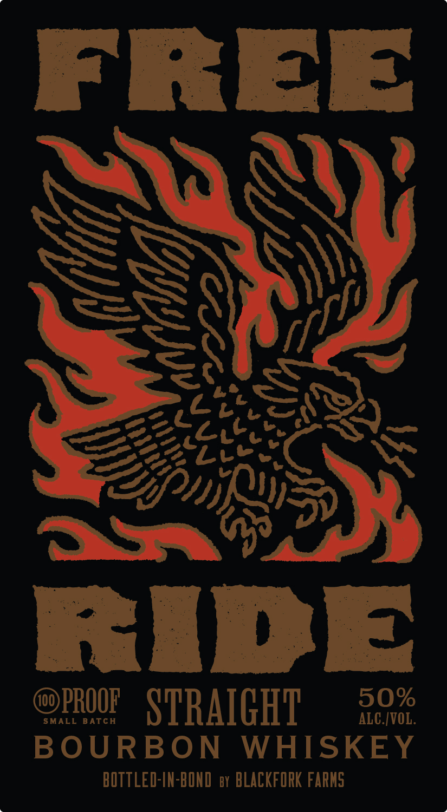
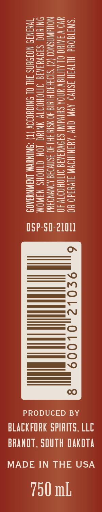

# TTB COLA Label Images - TTBID 26253001000492

**Brand Name:** FREE RIDE

**Issue Date:** 10/09/2026

**Origin Code:** 42

**Product Class/Type:** 111

**Source:** [TTB Public COLA Registry](https://ttbonline.gov/colasonline/viewColaDetails.do?action=publicFormDisplay&ttbid=26253001000492)

## Label Images

### Front Label

### Label 2

## Extracted Label Text

*Text extracted via OCR - may contain errors*

### Front Label

FREE

‘WS

SS

SS

a

\\

fi

=¢

ily

LON

Fees SO,

3st

Lre

mck

Se

Bly J

VF)

RIDE

@PROOF STRAIGHT

SMALL BATCH

ae

BOURBON WHISKEY

BOTTLED-IN-BOND ey BLACKFORK FARMS

### Label 2

“SWI1GOUd HITVIH 3SN¥O AV ONY ‘AUINIHOVN 3LV43d0 YO
WYO VINUC OLALITICV UNOA SUIVAINI SIDVUIATG JOH OITY 40
NOWAWASNOO (2) ‘S103430 HIMI@ 40 SIH SH 40 ISNVOIS ANN Ud
NING SIOVUIATE ITTOHOITY NING LON CINOWS NAWOM
TWHINI9 NOFSYNS FHL OL ONIGHOOOY (7) =SNINYVM INAWNYAOD

-SD-21011

05P

6

9c0L2

L

PRODUCED BY
BLACKFORK SPIRITS, LLC

BRANDT, SOUTH DAKOTA

MADE IN THE USA

750 mL
