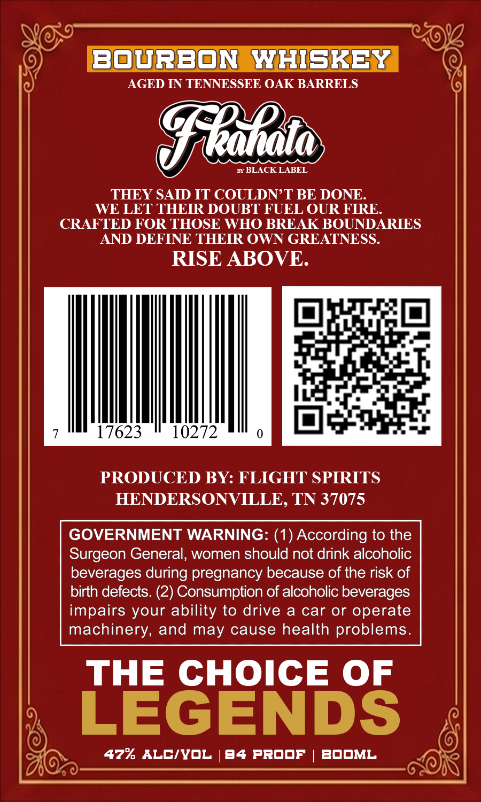
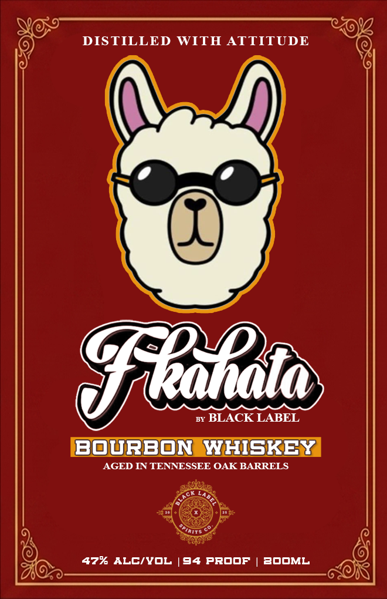

# TTB COLA Label Images - TTBID 26253001000833

**Brand Name:** BLACK LABEL

**Issue Date:** 10/14/2026

**Origin Code:** 43

**Product Class/Type:** 141

**Source:** [TTB Public COLA Registry](https://ttbonline.gov/colasonline/viewColaDetails.do?action=publicFormDisplay&ttbid=26253001000833)

## Label Images

### Back Label

### Label 1

## Extracted Label Text

*Text extracted via OCR - may contain errors*

**Detected Proof:** 94

### Back Label

Bourbon
WHISKEY
AGED IN TENNESSEE OAK BARRELS
Fllato
Brx BLACK LABEL
THEY SAID IT COULDN T BE DONE
WE LET THEIR DOUBT FUEL OUR FIRE
CRAFTED FOR THOSE WHO BREAK BOUNDARIES
AND DEFINE THEIR OWN GREATNESS:
RISE ABOVE.
17623
10272
PRODUCED BY: FLIGHT SPIRITS
HENDERSONVILLE, TN 37075
GOVERNMENT WARNING: (1) According to the
Surgeon General, women should not drink alcoholic
beverages during pregnancy because of the risk of
birth defects. (2) Consumption of alcoholic beverages
impairs your ability to drive a
car or operate
machinery, and may cause health problems.
THE CHOICE OF
LEGENDS
47% ALCIYOL
94 PROOF
BOOML

### Label 1

DISTILLED WITH ATTITUDE
Fledlt
BLACK LABEL
BovrBOn WHISKEY
AGED IN TENNESSEE OAK BARRELS
47% ALCIvOL
94 PRODF
3OOML
