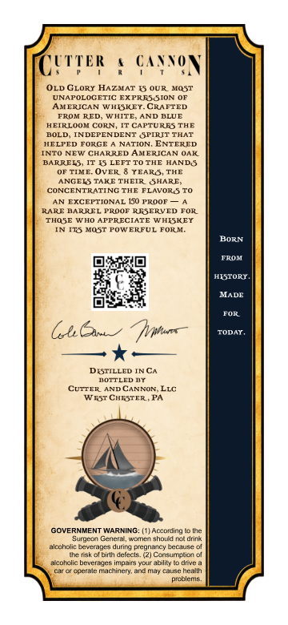
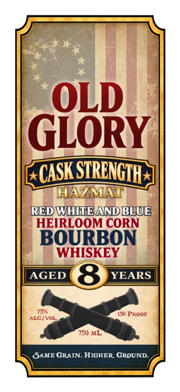

# TTB COLA Label Images - TTBID 26253001000849

**Brand Name:** OLD GLORY

**Issue Date:** 10/14/2026

**Origin Code:** 39

**Product Class/Type:** 141

**Source:** [TTB Public COLA Registry](https://ttbonline.gov/colasonline/viewColaDetails.do?action=publicFormDisplay&ttbid=26253001000849)

## Label Images

### Back Label

### Front Label

## Extracted Label Text

*Text extracted via OCR - may contain errors*

**Detected Proof:** 150
**Detected Age:** 8 Years

### Back Label

GA_voN
OLD CLORY HAZMAT IS OUR MOST
UNAPOLOGETIC EXTRESSION OF
AMERICAN W HISKEY_
CEAFTED
LepapaE
WMITT
4N BLUT
HEIRLDOK CORN [TCAFTURES THE
LOLD
INDEPENDENT SPIRIT THAT
HELPED FORGE
NATION
ENTERED
IattoRas Um
EHAARE
AMERICAN QAK
BARRED'
IS LEFT TO THE HAND S
OF TIME. OvER
YEARS, THE
ANGELS TAKE THEIR
AHARE
CONCENTRATING
FLAVOR S
EXCEPTIONAL
150 TROOF
kL
MAEREI
Pkdul
REJERVED
THQSE
LnE
AaFmRCECAE
WHISKEY
ITS MOST POWERFUL
FORH
BORN
TROM
Caeeama
MADE
FOR
Gekn
Todar
DESTILLED INCA
HOTTLED T
CUTTER
ANDCNNOR
WEST CHESTER
GOVERNMENT WARNING: (1) Accbfdirig
Sunueji
Eerienal
winna shouldT&dtinte
alcoholi: Beveror ; durina Dicunac
IGuta
[e ekolbirlh delecl?
"21Ccixinibo
Jcbt clic beverages inipaains your abilily
dinti
cperale n Cnirety ana niay €ause: heallh
picblenis
CTTER

### Front Label

OLD
GLORY
STRCNGTH
HAZMAT
REDWHVTEANDBLUE
HEIRLOOM CORN
BOURBON
WHISKEY
AGED
8
YEARS
75/
150 PROOF
ALCH VOL
750 ML
SAME GRAIN. HIGHER GROUND
CASKE
