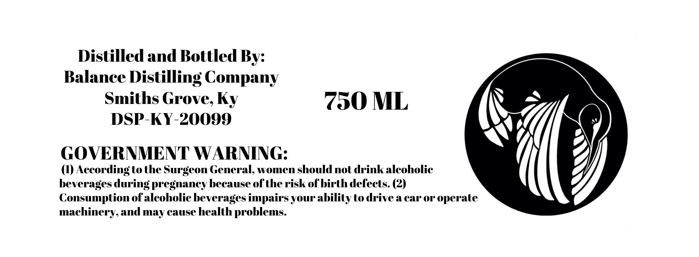
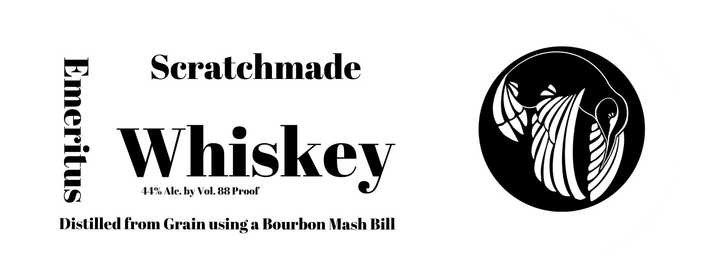

# TTB COLA Label Images - TTBID 26257001000534

**Brand Name:** EMERITUS

**Fanciful Name:** SCRATCHMADE

**Issue Date:** 10/15/2026

**Origin Code:** 22

**Product Class/Type:** 140

**Source:** [TTB Public COLA Registry](https://ttbonline.gov/colasonline/viewColaDetails.do?action=publicFormDisplay&ttbid=26257001000534)

## Label Images

### Back Label

### Label 1

## Extracted Label Text

*Text extracted via OCR - may contain errors*

**Detected Proof:** 88

### Back Label

Distilled and Bottled By:
Balance Distilling Company
Smiths Grove, Ky 750 ML
DSP-KY-20099

GOVERNMENT WARNING:

(1) According to the Surgeon General, women should not drink alcoholic
beverages during pregnancy because of the risk of birth defects. (2)
Consumption of alcoholic beverages impairs your ability to drive a car or operate

machinery, and may cause health problems.

### Label 1

Scratchmade
Fwiskcy
44% Ale: by Vol. 88 Proof
Distilled from Grain using a Bourbon Mash Bill
