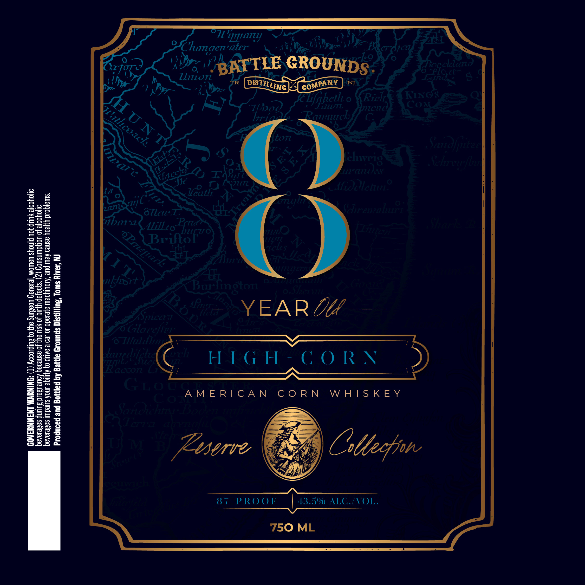

# TTB COLA Label Images - TTBID 26257001000671

**Brand Name:** BATTLE GROUNDS DISTILLING CO.

**Fanciful Name:** AMERICAN CORN WHISKEY

**Issue Date:** 10/14/2026

**Origin Code:** 03

**Product Class/Type:** 143

**Source:** [TTB Public COLA Registry](https://ttbonline.gov/colasonline/viewColaDetails.do?action=publicFormDisplay&ttbid=26257001000671)

## Label Images

### Label 1

## Extracted Label Text

*Text extracted via OCR - may contain errors*

### Label 1

"111114
Clumgen"aier
Ico
GROUNDS
Reccliand
Lliion
TR
NJ
Hihetl .
0
RicIL
HIIC<
LLFL
JZGlg
COA
Raunirch
Ltni
1
8
U
44
Sandfjutad
Cehrewfb
T4P
ICLiaa
3i
F4
Jc
Jeatl?-
CVJz4Tz
Lolctuc
H

(dienealg
oTlru
3
4
S1bow-
AilLzo Pctia

2
Brifo
Vriz@)
azfte
8
]
8
=
LCLGs
1
1
1
3z
2
7v
ldibrt
6a
Iii
Burtington
SEcril
3
Go
11
Yoniczzo
ABa
YEAR De
228
Glaceffun:
oui
3e
8
28
6
1
6 Tllulule
5
0
2
1
Vepe difciee
Urch
H I 6 H - € 0 RN
=
Eacxon
jeL
G1oo AM ERICAN
C 0 R N
W H |S K E Y
1
!
3
Saroichiy Bocat
Ix
Aisvan6
hno
DLM

Zsserie
Cttecfjone
3
8 7
PRO 0F
43.50 ALG /VOL.
3
750 ML
BATTLE
DISTILLING
COMPANY
HuNT
Whcoach
Uclvri8
6 R`
1
TlaccHi
LA
zan
llin
QPau[nick
MI T5
3
KiLl
5
3
1
S
1
