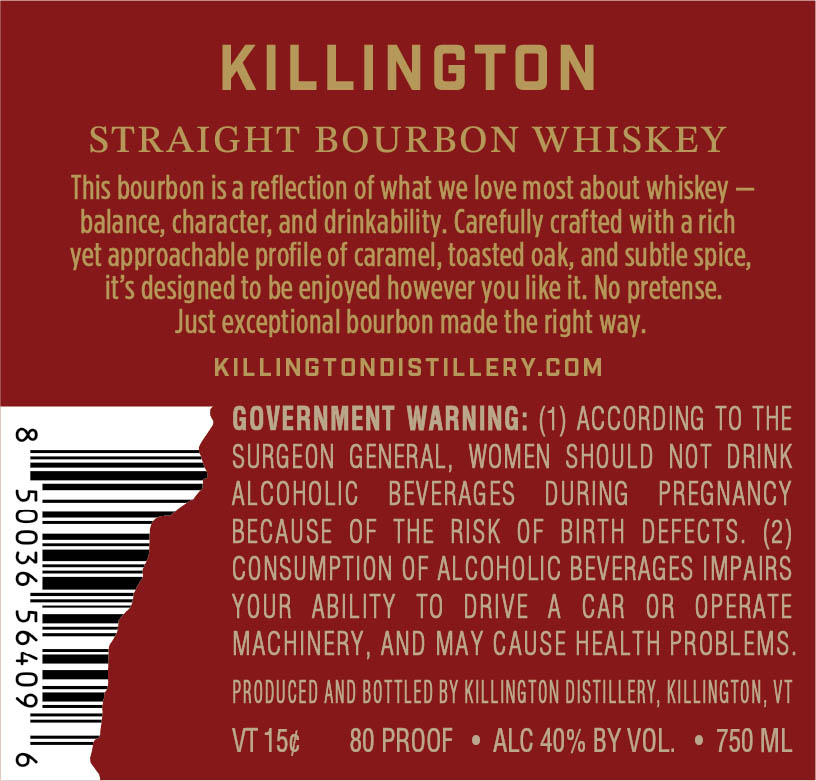
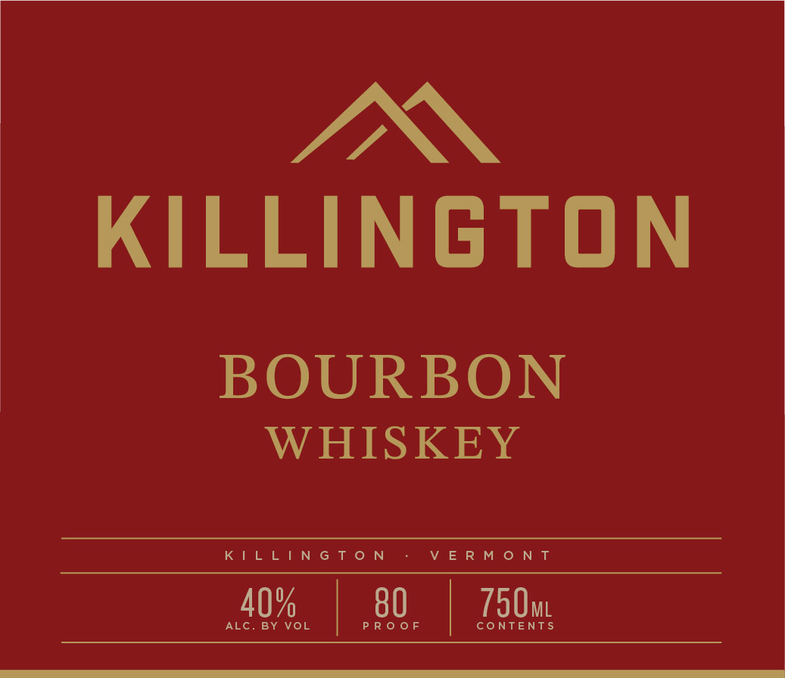
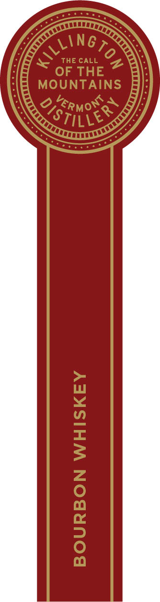

# TTB COLA Label Images - TTBID 26260001000301

**Brand Name:** KILLINGTON DISTILLERY

**Issue Date:** 10/13/2026

**Origin Code:** 46

**Product Class/Type:** 101

**Source:** [TTB Public COLA Registry](https://ttbonline.gov/colasonline/viewColaDetails.do?action=publicFormDisplay&ttbid=26260001000301)

## Label Images

### Back Label

### Label 1

### Label 3

## Extracted Label Text

*Text extracted via OCR - may contain errors*

**Detected Proof:** 80

### Back Label

KILLINGTON
STRAIGHT BOURBON WHISKEY
This bourbon isa reflection of what we love most about whiskey
balance; character; and drinkability. Carefully crafted with a rich
yet approachable profile of caramel, toasted oak; and subtle spice;
its designed to be enjoyed however you like it. No pretense:
Just exceptional bourbon made the right way:
KILLINGTONDISTILLERY.COM
0
GOVERNMENT WARNING: (1) ACCORDING TO THE
SURGEON  GENERAL ,  WOMEN  SHOULD NOT  DRINK
ALCOHOLIC
BEVERAGES
DURING
PREGNANCY
3
BECAUSE OF THE RISK OF BIRTH DEFECTS. (2)
CONSUMPTION OF ALCOHOLIC BEVERAGES IMPAIRS
YOUR
ABILITY   TO
DRIVE
A
CAR
OR   OPERATE
8
MACHINERY, AND May CAUSE HEALTH PROBLEMS.
PRODUCED AND BOTTLEd BY KILLINGTON DiStILLeRY; KILLINGTON, VT
VT 150
80 PROOF
ALC 40% BY VOL.
750 ML
0

### Label 1

IN

KILLINGTON

BOURBON

WHISKEY

KILLINGTON VERMONT

40%, | 80, | 750m

### Label 3

THE CALL
2
OF THE
MOUNTAINS
ZRMorQ`
1
1
Aling 0
QisthiSS
