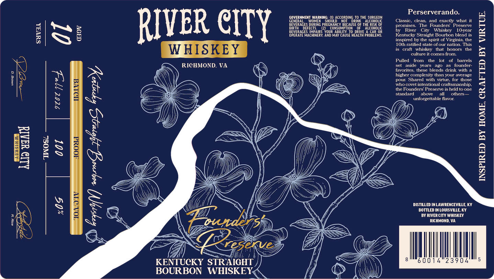

# TTB COLA Label Images - TTBID 26262001000124

**Brand Name:** RIVER CITY WHISKEY

**Issue Date:** 11/10/2026

**Origin Code:** 22

**Product Class/Type:** 101

**Source:** [TTB Public COLA Registry](https://ttbonline.gov/colasonline/viewColaDetails.do?action=publicFormDisplay&ttbid=26262001000124)

## Label Images

### Label 1

### Label 2

## Extracted Label Text

*Text extracted via OCR - may contain errors*

*1 image(s) excluded: text did not meet readability threshold*

### Label 1

EI

9 Waal
"TINOSL

Suvas

RIVER CITY

WHISKEY

id RICHMOND, VA iS)

BOURBON WHISKEY,

GOVERNMENT WARNING: () ACCORDING TO THE SURGEON

NERAL WOMEN SHOULD NOT. DRINK ALCOHOLIC
BEVERAGES DURING PREGNANCY BECAUSE OF THE RISK OF
BIRTH DEFECTS. (2) CONSUMPTION OF ALCOHOLIC
BEVERAGES IMPAIRS YOUR ABILITY TO DRIVE A CAR OR
‘OPERATE MACHINERY, AND MAV CAUSE HEALTH PROBLEMS,

Perserverando.

Classic, clean, and exactly what it
promises. The Founders’ Preserve
River City Whit 10-year
Kentucky Straight Bourbon blend is
inspired by the spirit of Virginia, the
10th ratified state of our nation. This
is craft whiskey that honors the
‘culture it comes from.
Pulled from the lot of barrels
set aside years ago as founder-
favorites, these blends drink with a
higher complexity than your average
pour. Shared with virtue, for those
who covet intentional craftsmanship,
the Founders’ Preserve is held to one
standard above all others—
unforgettable flavor.

DISTILLED INLAWRENCEVILLE, KY.
BOTTLED IN LOUISVILLE, KY
BY RIVERCITY WHISKEY
RICHMOND, VA
3904

NL

ge60014

INSPIRED BY HOME, CRAFTED BY VIRTUE.
