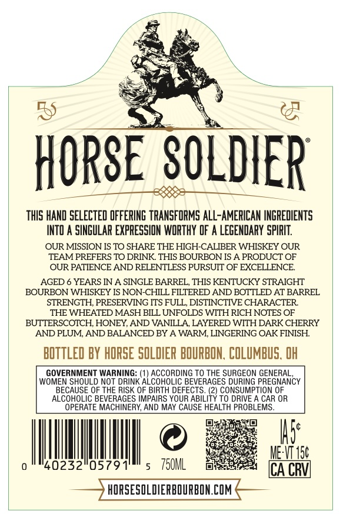
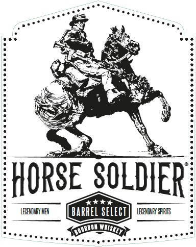
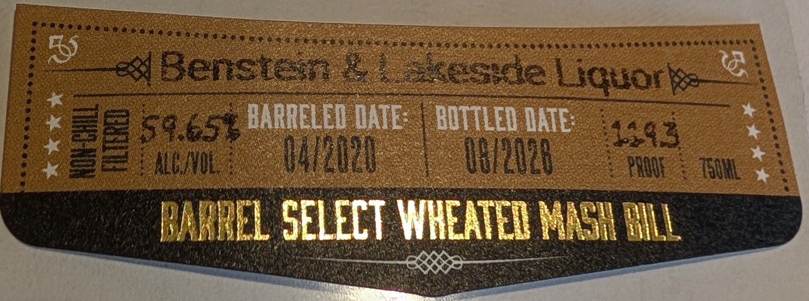
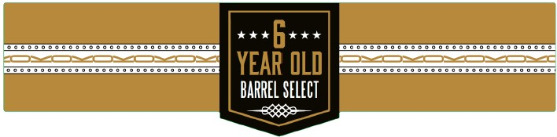

# TTB COLA Label Images - TTBID 26264001000522

**Brand Name:** HORSE SOLDIER

**Issue Date:** 10/13/2026

**Origin Code:** 09

**Product Class/Type:** 141

**Source:** [TTB Public COLA Registry](https://ttbonline.gov/colasonline/viewColaDetails.do?action=publicFormDisplay&ttbid=26264001000522)

## Label Images

### Back Label

### Front Label

### Label 2

### Label 3

### Label 5

## Extracted Label Text

*Text extracted via OCR - may contain errors*

*1 image(s) excluded: text did not meet readability threshold*

### Back Label

HORSE SOLDIER
ThIS HAND SELECTED OFFERING TRANSFORMS alL-AMERICAN INGREDIENTS
INTO A SINGULAR EXPRESSION WORTHY DF A LeGEndaRY spIRIT
OUR MISSION IS TO SHARE THE HIGH-CALIBER WHISKEY OUR
TEAM PREFERS TO DRINK THIS BOURBON IS A PRODUCT OF
OUR PATIENCE AND RELENTLESS PURSUIT OF EXCELLENCE
AGED
YEARS IN A SINGLE BARREL, THIS KENTUCKY STRAIGHT
BOURBON WHISKEY IS NON-CHILL FILTERED AND BOTTLED AT BARREL
STRENGTH, PRESERVING ITS FULL, DISTINCTIVE CHARACTER
THE WHEATED MASH BILL UNFOLDS WITH RICH NOTES OF
BUTTERSCOTCH, HONEY, AND VANILLA LAYERED WITH DARK CHERRY
AND PLUM, AND BALANCED BY A WARM, LINGERING OAK FINISH
BOTTLED BY HORSE SOLDIER BOURBON, COLUMBuS, OH
GOVERNMENT WARNING:
ACCORDING TO THE SURGEON GENERAL
WOMEN SHOULD NOT DRINK
'ALCOCoEIC BEVERAGES DURENG PREGIANCY
BECAUSE OF THE RISK OF BIRTH DEFECTS. (2) CONSUMPTION OF
ALCOHOLIC BEVERAGES IMPAIRS YOUR ABILI
TO DRIVE
CAR OR
ERATE MACHINERY, AND MAY CAUSE HEALTH PROBLEMS
Is:
MEWIS
40232"05791'
750ML
ICA CRVL
HORSESOLDIERBOURBON.COM

### Front Label

HORSE SOLDIER
#*4+
LEEENDAFY MEX
barrel select
LEGENDAFX SFHHITS

### Label 2

ri — dog aya ps Re pc
BS eee
Rab tae ieee Oo 2 eke eee 1 Sot . on
4 ( eae ne saaxzoomnies SCT Rea ee aces EN ON rE te
—AARRELED OATE: BOTTLED ATE: *
« ak sf SOSH a OR RS wy ee Rea wee RIGA mt ee :
ath Paes | ig ae ah ae | Geentcren seekers 1G ot BY A an ee
ey | te ae rer a | ' 2 hy AEA EAT |
RNREL SELECT WHEATED MASH IN
WV ele el Raval HOTU TALE RBS Wad SL
A POs eile i aauiies aaa tte AS aa es DENG ;
a ik ys as ee

### Label 5

SESE STTOSTTSSTSSSTOSTTOSTT

ea vee

SE TTOSTTOTTSOTTTSTEOSTSSSTOSTT

YEAR OL0

BARREL SELECT

eo
