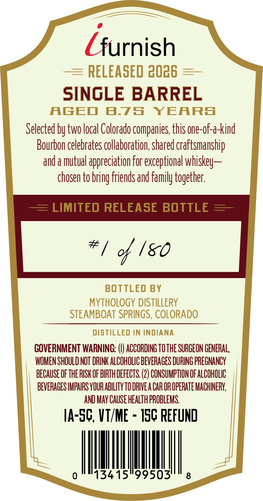
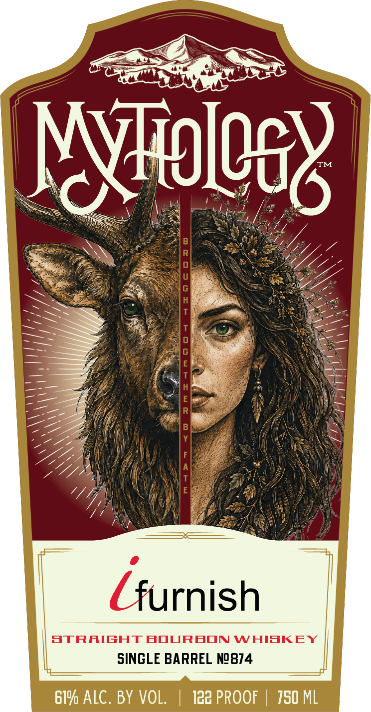

# TTB COLA Label Images - TTBID 26264001000744

**Brand Name:** MYTHOLOGY

**Issue Date:** 11/18/2026

**Origin Code:** 13

**Product Class/Type:** 101

**Source:** [TTB Public COLA Registry](https://ttbonline.gov/colasonline/viewColaDetails.do?action=publicFormDisplay&ttbid=26264001000744)

## Label Images

### Back Label

### Label 1

## Extracted Label Text

*Text extracted via OCR - may contain errors*

**Detected Proof:** 122
**Detected Age:** 8.75 Years

### Back Label

Cfurnish
ReLeaSed 3036
SINGLE BARREL
AGED
8.75
YEARS
Selected by two local Colorado companies, this one-of-a-kind
Bourbon celebrates collaboration,shared craftsmanship
and a mutual
Lappreciation for exceptionalwhiskey
chosen to bring friends and Family together:
LIMITEd RELEASE BOTTLE
# /
% I80
BOTTLED BY
MYTHOLOGY DISTILLERY
STEAMBOAT SPRINGS, COLORADO
DISTILLED IN INDIANA
COVERNMENT WARNING:
ACCORDING TOTHE SURGEON GENERAL,
WOMEN SHOULD NOT DRINK ALCOHOLIC BEVERAGES DURING PREGNANCY
BECAUSE OF THE RISK OF BIRTH DEFECTS, (2) CONSUMPTHON OF ALCOHOLIC
BEVERACES IMPAIRS VOUR ABILITY TO DRIVEA CAR OR OPERATE MACHINERV;
AND MAY CAUSE HEALTH PROBLEMS
IA-SG, VT/Me
ISC Refund
0
13415"99503'
8

### Label 1

Mvliolee&
R
:
1
F
f
E
lfurnish
ATRAIGHT BOURAON WHISKEY
SINCLE BARREL Ng874
G79 ALC . BY VOL.
122 PROOF
750 ML
