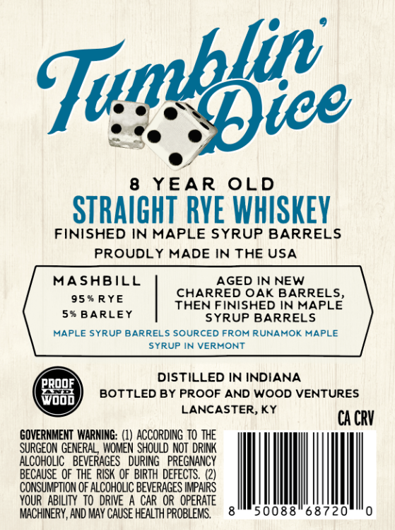
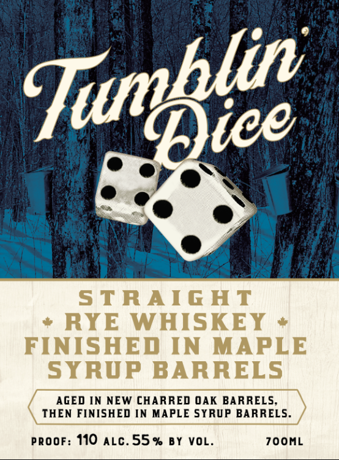

# TTB COLA Label Images - TTBID 26265001000456

**Brand Name:** TUMBLIN DICE

**Issue Date:** 10/29/2026

**Origin Code:** 22

**Product Class/Type:** 102

**Source:** [TTB Public COLA Registry](https://ttbonline.gov/colasonline/viewColaDetails.do?action=publicFormDisplay&ttbid=26265001000456)

## Label Images

### Back Label

### Front Label

## Extracted Label Text

*Text extracted via OCR - may contain errors*

**Detected Proof:** 110
**Detected Age:** 8 Years

### Back Label

8
YEAR
OLD
STRAIGHT RVE WHISKEV
FINISHED IN MAPLE SYRUP BARRELS
PROUDLY MADE IN THE USA
MASHBILL
AGED IN NEW
CHARRED OAK BARRELS;
95 % RYE
THEN FINISHED IN MAPLE
5* BARLEY
SYRUP BARRELS
HAPLE SYRUP BARRELS SOURCED FROM RUNAHOK HAPLE
SYRUP IN VERHONT
DISTILLED IN INDIANA
'PROOE
BOTTLED BY PROOF AND WOOD VENTURES
Wdod
LANCASTER
KY
CA CRV
GOVERNMENT WARNING: (W) ACCORDING TO THE
SURGEON GENERAL, WOMEN SHOULD NOT  DRINK
ALCOHOLIC   BEVERAGES   DURING   PREGNANCY
BECAUSE QF THE  RISK OF   BIRTH DEFECTS.
CONSUMPTION OF ALCOHOLIC BEVERAGES IMPAIRS
YOUR   ABILITY  TO  DRIVE A CAR OR OPERATE
MACHINERY , AND MAY CAUSE HEALTH PROBLEMS ,
50088
68720
Tupbfice

### Front Label

STRAIG HT
RYE
WHISKEY
FINISHED IN MAPLE
SYRUP BARRELS
AGED IN NEW CHARRED OAK BARRELS
THEN FINISHED N MAPLE SYRUP BARRELS.
PROOF: 110 ALC.55 % By VOL
700ML
Tunblic
