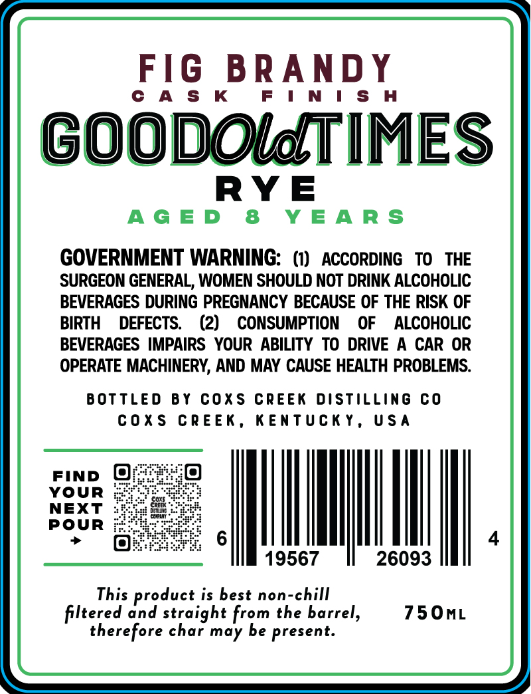
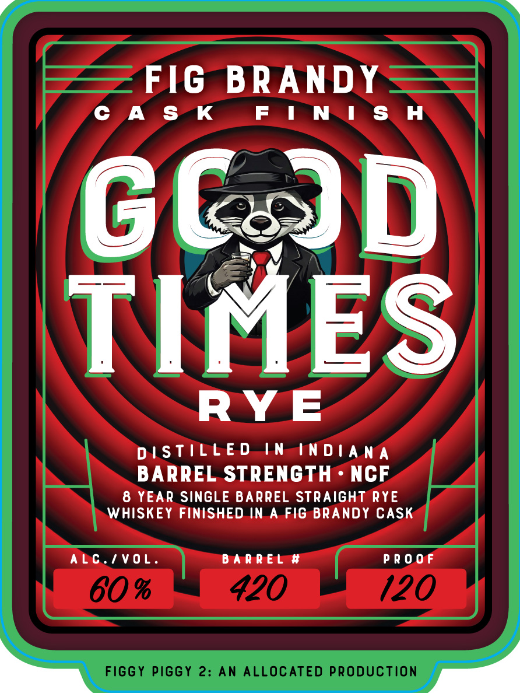

# TTB COLA Label Images - TTBID 26266001000168

**Brand Name:** GOOD TIMES

**Fanciful Name:** FIG BRANDY CASK FINISH

**Issue Date:** 10/16/2026

**Origin Code:** 22

**Product Class/Type:** 102

**Source:** [TTB Public COLA Registry](https://ttbonline.gov/colasonline/viewColaDetails.do?action=publicFormDisplay&ttbid=26266001000168)

## Label Images

### Back Label

### Front Label

## Extracted Label Text

*Text extracted via OCR - may contain errors*

**Detected Age:** 8 Years

### Back Label

FIG BRANDY

CAS K

FINISH

GOODOldTIMES

RYE

AGED 8 YEARS

GOVERNMENT WARNING: (1) ACCORDING TO THE

SURGEON GENERAL, WOMEN SHOULD NOT DRINK ALCOHOLIC

BEVERAGES DURING PREGNANCY BECAUSE OF THE RISK OF

BIRTH DEFECTS. (2) CONSUMPTION OF ALCOHOLIC

BEVERAGES IMPAIRS YOUR ABILITY TO DRIVE A CAR OR

OPERATE MACHINERY, AND MAY CAUSE HEALTH PROBLEMS.

BOTTLED BY COXS CREEK DISTILLING CO

COXS CREEK, KENTUCKY, USA

FIND @

YOUR

NEXT

POUR

IM

4

J

19567

26093

This product is best non-chill

750mL

filtered and straight from the barrel,

therefore char may be present.

### Front Label

FIG BRANDY

CAS K FIN IS H

DISTILLED IN-INDIANA

BARREL STRENGTH NCF

8 YEAR SINGLE BARREL STRAIGHT RYE
WHISKEY FINISHED.IN.A.FIG BRANDY CASK

AbC./VOL. BARREL # PROOF
