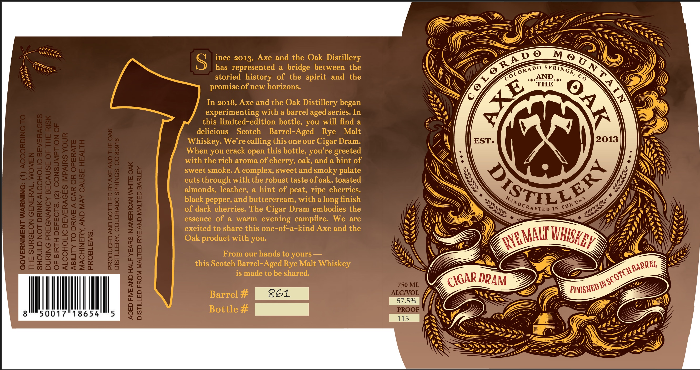
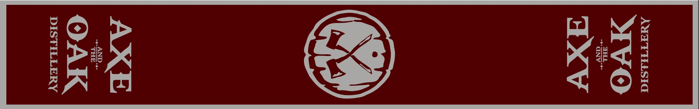

# TTB COLA Label Images - TTBID 26266001000319

**Brand Name:** AXE AND THE OAK DISTILLERY

**Issue Date:** 11/17/2026

**Origin Code:** 13

**Product Class/Type:** 118

**Source:** [TTB Public COLA Registry](https://ttbonline.gov/colasonline/viewColaDetails.do?action=publicFormDisplay&ttbid=26266001000319)

## Label Images

### Label 1

### Label 2

## Extracted Label Text

*Text extracted via OCR - may contain errors*

*1 image(s) excluded: text did not meet readability threshold*

**Detected Proof:** 115

### Label 1

S
ince 2013, Axe and the Oak Distillery
has  represented & bridge between the
0
storied history of the
and the
AND
promise of new horizons
TFHE
In 2018, Axe and the Oak Distillery began
experimenting with a barrel
series: In
@
this limited-edition bottle, you will find &
H
6
3
delicious
Scotch
Barrel-Aged
Rye
Malt
2013
Whiskey. We re calling this one our
Dram.
ESF _
J
6
M
08
When you crack open this bottle, you re greeted
3
1
98
with the rich aroma of cherry, oak, anda hint of
8
sweet smoke. A complex, sweet and smoky palate
J
8
3
UH
cutotldoUeathith theiobusf peste ofpe cheasted
SizA
U
N
I
33
1
8
bladarpepberriad bbe €cger Drantkalodd
Gnise
FTED IN
3
H
2
Il
2
essence of a
warm
evening  campfire: We
are
2
2
excited to share this one-of-a-kind Axe and the
1
2
@
Oak product with you:
1
4
Ii
6
MM KH
this Scotcb Barehagds_ yeMalt Whiskey
is made to be shared:
2
750 ML
In
J
Barrel #
861
A5G .594
8
50017
18654
5
0
Bottle #
PROOF
115
RAD 0
MoUNTAlV
SPRINGS,
OLORADO
spirit
1
2
aged
Cigar
long
HANDCRA
USA
THE
WHISKEY
RYBMAIT E
BARREL
[SCOTCH E
CIGAR
DRam
FINISHED
