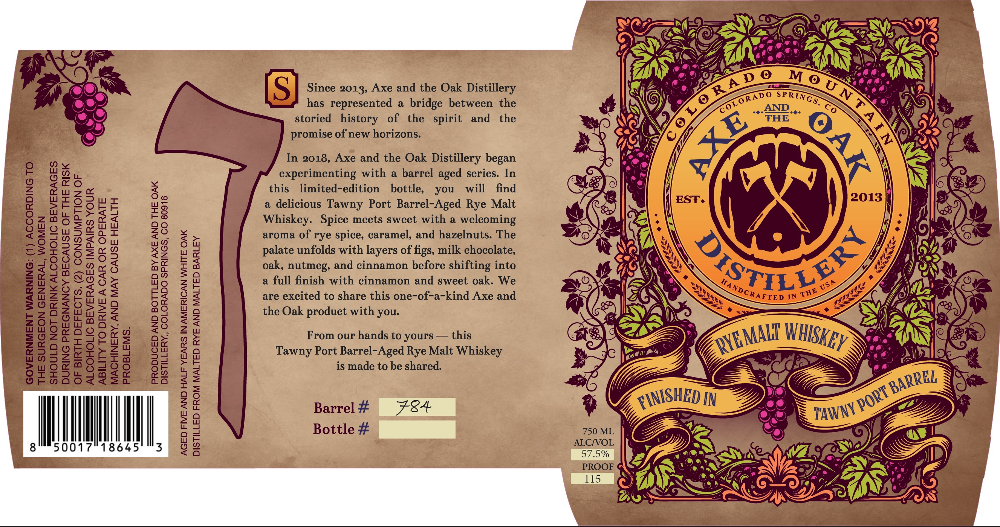
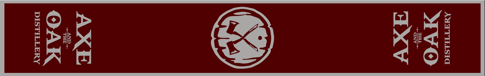

# TTB COLA Label Images - TTBID 26266001000329

**Brand Name:** AXE AND THE OAK DISTILLERY

**Issue Date:** 11/17/2026

**Origin Code:** 13

**Product Class/Type:** 118

**Source:** [TTB Public COLA Registry](https://ttbonline.gov/colasonline/viewColaDetails.do?action=publicFormDisplay&ttbid=26266001000329)

## Label Images

### Label 1

### Label 2

## Extracted Label Text

*Text extracted via OCR - may contain errors*

*1 image(s) excluded: text did not meet readability threshold*

**Detected Proof:** 115

### Label 1

S
Since 2013, Axe and the Oak Distillery
O
has   represented
a
bridge between the
0
AN_
storied   history
of
the
spirit
and
the
FHE
promise of new horizons
In 2018, Axe and the Oak Distillery began
2
2
experimenting with
a barrel
series. In
5
I
3
this
limited-edition
bottle,
you
will
find
ESF _
2013
1
8
28
a delicious Tawny Port Barrel-Aged Rye Malt
1
Hu
38
aroma
Woisk of  Spiqicaectramel and hazelelcozaihe
2
J
8
3
HH
palataunfoldsnd b hanoo/ feforeikichogghato
<nv
U
~
33
0
a full finish with cinnamon and sweet oak. We
3
I
<
Hl
are excited to share this one-of-a-kind Axe and
FTED IN
M
2
2
2
the Oak product with you:
1
2
2
2
@
From our hands to yours
this
MAl" `
Ma KH
Tawny Port Barade-t oe ShaeBdalt Whiskey
4
6

Barrel #
784
IN
0
Bottle #
750 ML
ALCIOL
8
50017
18645
3
57.5%
PROOF
115
RAD 0
MoNTAN
SPRINGS_
OLORADO
1
%
aged
HANDCRA
USA
THE
WHISKEY
RYEA
BARREL
'PORT [
FINISHED
TAWNY =
