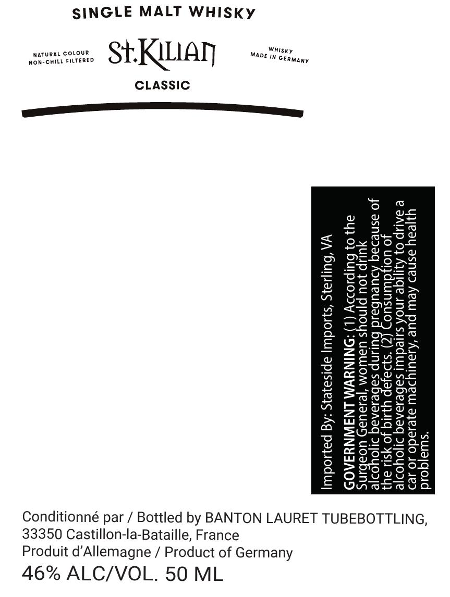

# TTB COLA Label Images - TTBID 26266001000398

**Brand Name:** ST. KILIAN

**Fanciful Name:** CLASSIC

**Issue Date:** 10/19/2026

**Origin Code:** 53

**Product Class/Type:** 118

**Source:** [TTB Public COLA Registry](https://ttbonline.gov/colasonline/viewColaDetails.do?action=publicFormDisplay&ttbid=26266001000398)

## Label Images

### Label 1

## Extracted Label Text

*Text extracted via OCR - may contain errors*

**Detected Proof:** 92

### Label 1

SINGLE MALT WHISKky

CLASSIC

ujjeay asneo Aew pue ‘Asaulysew ajesado
@ IAUP 0} Ajtjiqe ANOA sureduul sabesavaq
Jo UO: ee) kc Seep yyig Jo ys ayy
Jo asnedaq Adueubaid HuLNp sebesanaq D1joYor|e

ULIp Jou Pinoys UaWOM ‘|e1aUay Uoabins
34} 0} DuIpI0D>V (L) “NINYWM LNAWNYSA09

VA ‘Buljiars ‘syuodu] apisayeys :Ag payoduy|

Whisky
'N GERMany

Mave

Conditionné par / Bottled by BANTON LAURET TUBEBOTTLING,

33350 Castillon-la-Bataille, France

Produit d’Allemagne / Product of Germany

46% ALC/VOL. 50 ML
