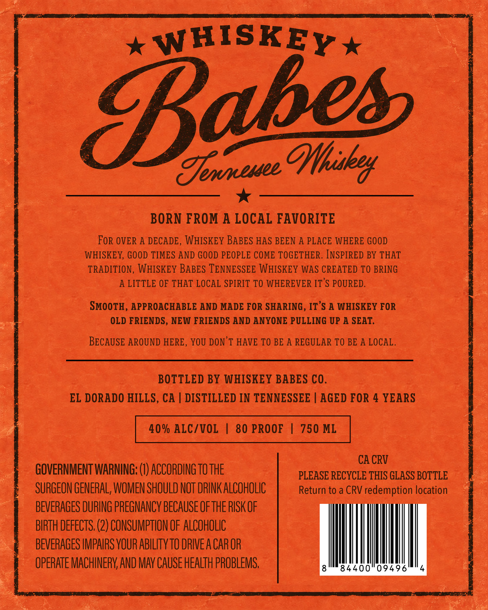
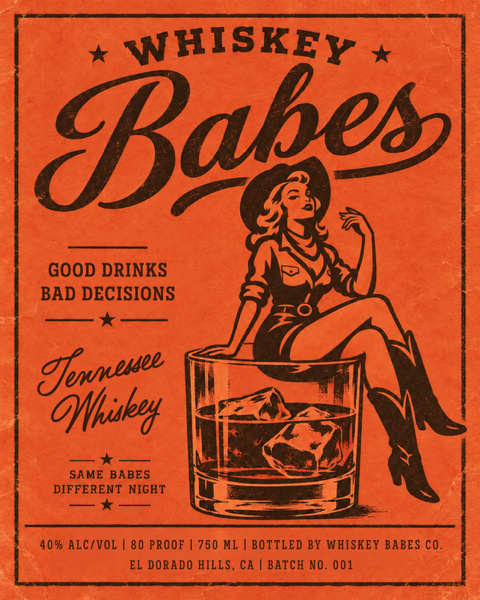

# TTB COLA Label Images - TTBID 26266001000861

**Brand Name:** WHISKEY BABES

**Issue Date:** 10/29/2026

**Origin Code:** 01

**Product Class/Type:** 140

**Source:** [TTB Public COLA Registry](https://ttbonline.gov/colasonline/viewColaDetails.do?action=publicFormDisplay&ttbid=26266001000861)

## Label Images

### Back Label

### Front Label

## Extracted Label Text

*Text extracted via OCR - may contain errors*

**Detected Proof:** 80
**Detected Age:** 4 Years

### Back Label

WHISKEY
Efomeuez OHhuaka
BORN FROM A LOCAL FAVORITE
FoR OVER A DECADE, WHISKEY BABES HAS BEEN A PLACE WHERE GOOD
WHISKEY, GOOD TIMES AND GOOD PEOPLE COME TOGETHER. INSPIRED BY THAT
TRADITION, WHISKEY BABES TENNESSEE WHISKEY WAS CREATED TO BRING
A LITTLE OF THAT LOCAL SPIRIT TO WHEREVER IT'S POURED.
SMOOTH, APPROACHABLE AND MADE FOR SHARING , IT'S A WHISKEY FOR
OLD FRIENDS, NEW FRIENDS AND ANYONE PULLING UP A SEAT_
BECAUSE AROUND HERE
YOU DON'T HAVE TO BE A REGULAR TO BE A LOCAL
BOTTLED BY WHISKEY BABES CO.
EL DORADO HILLS, CA
DISTILLED IN TENNESSEE
AGED FOR 4 YEARS
40% ALC/VOL
80 PROOF
750 ML
CA CRV
GOVERNMENT WARNING; (€) ACCORDING TO THE
PLEASE RECYCLE THIS GLASS BOTTLE
SURGEON GENERAL; WOMEN SHOULD NOT DRINK ALCOHOLIC
Return to a CRV
redemption location
BEVERAGES DURING PREGNANCY BECAUSE OFTHE RISK OF
BIRTH DEFECTS; (2) CONSUMPTHON OF ALCOHOLIC
BEVERAGES IMPAIRS YOUR ABILITY TO DRIVEA CAR OR
OPERATE MACHINERV AND MAv Cause HEALTH PROBLEMS
84400"09496'
Eabes

### Front Label

WHISKEY
Baoes|
GOOD DRINKS
BAD DECISIONS
Efnxeuee
' OHtiuked
SAME BABES
DIFFERENT NIGHT
40% ALC/VOL
80 PROOF
750 ML
BOTTLED BY WHISKEY BABES CO_
EL DORADO HILLS,
BATCH NO_
001
