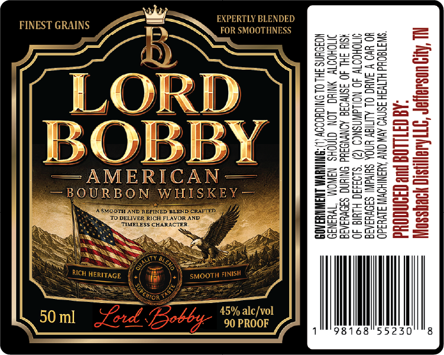

# TTB COLA Label Images - TTBID 26267001000230

**Brand Name:** LORD BOBBY AMERICAN BOURBON WHISKEY

**Issue Date:** 10/14/2026

**Origin Code:** 43

**Product Class/Type:** 141

**Source:** [TTB Public COLA Registry](https://ttbonline.gov/colasonline/viewColaDetails.do?action=publicFormDisplay&ttbid=26267001000230)

## Label Images

### Label 1

## Extracted Label Text

*Text extracted via OCR - may contain errors*

### Label 1

AL Ag uosuayer “STH AuayINs1q YoeqssOy
AQ CTLLOG Hue ONCOd

“SWI TEQUd HITVSH ASNVO AVW ONY AYINIHOWW SLIGO
HO Uo ¥ SANG OL ALMIY UNDA SulvaWI SFO¥UIAIE
OHOOTY 40 NOILdWNSNCO (2) “SLO3430 Hula 40
¥SI4 HL 40 3SNVO3d AONWWOSHd ONIUNG S3I0VuIAIE
IOCHOOTY YNIYO LON CINOHS NAWOM “I¥u3N39
NOJOYNS 3HL OL ONICHOOOY L)-SNINYW LNAI AOS
