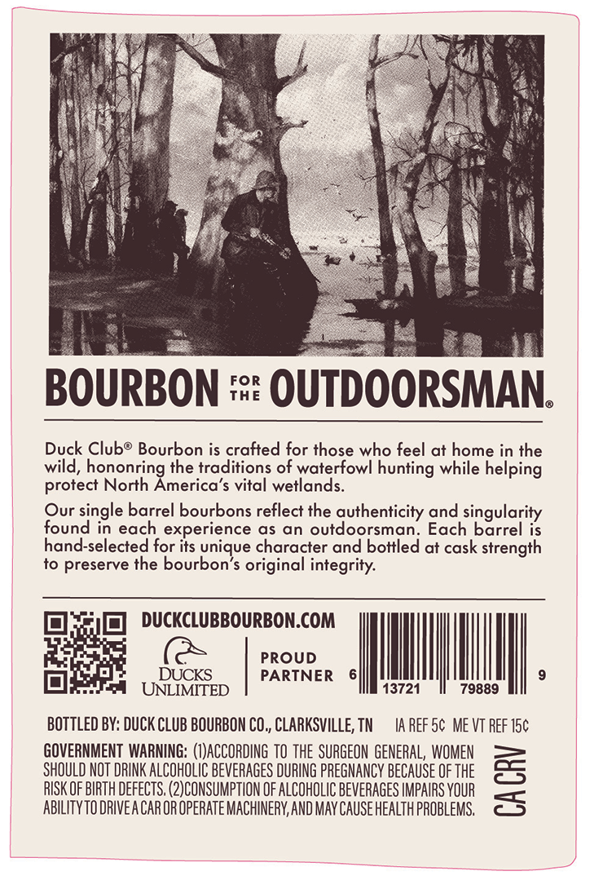
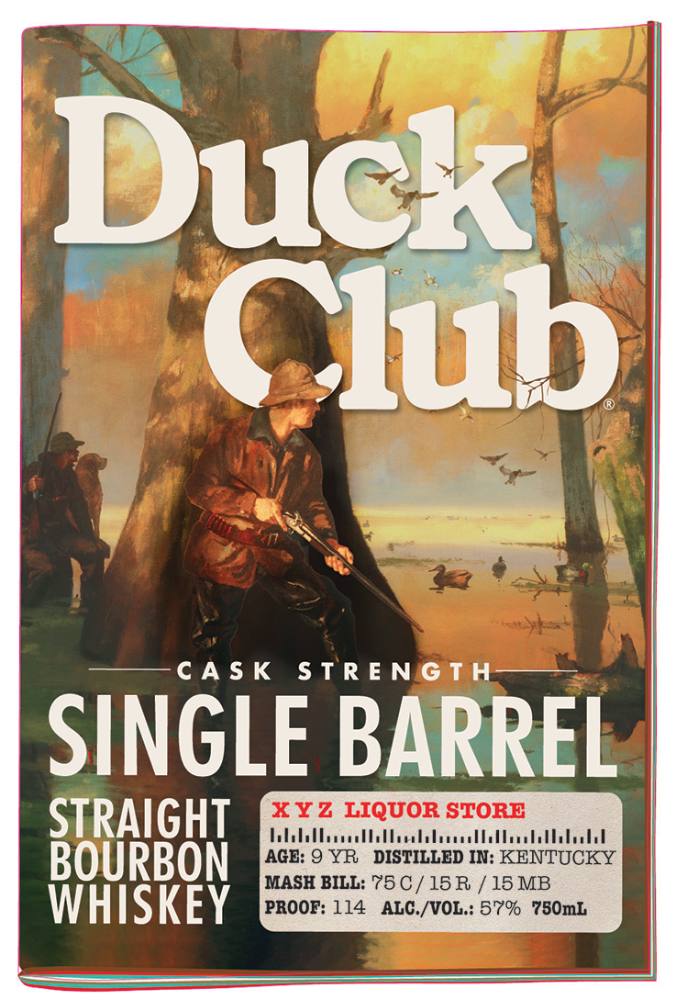

# TTB COLA Label Images - TTBID 26267001000730

**Brand Name:** DUCK CLUB

**Issue Date:** 10/13/2026

**Origin Code:** 43

**Product Class/Type:** 101

**Source:** [TTB Public COLA Registry](https://ttbonline.gov/colasonline/viewColaDetails.do?action=publicFormDisplay&ttbid=26267001000730)

## Label Images

### Back Label

### Front Label

### Label 2

## Extracted Label Text

*Text extracted via OCR - may contain errors*

*1 image(s) excluded: text did not meet readability threshold*

### Back Label

FOR
BOURBON
THE
OUTDOORSMAN
Duck Clubo Bourbon is crafted for those who feel at home in the
wild, hononring the traditions of waterfowl hunting while helping
protect North America's vital wetlands.
Our single barrel bourbons reflect the authenticity and singularity
found in each experience as an outdoorsman: Each barrel is
hand-selected for its unique character and bottled at cask strength
to preserve the bourbon'$ original integrity:
DUCKCLUBBOURBON.COM
PROUD
DUCKS
PARTNER
UNLIMITED
13721
79889
BOTTLED BY: DUCK CLUB BOURBON CO ,, CLARKSVILLE, TN
IA Ref 5c ME VT ReF I5c
GOVERNMENT WARNING: (I)ACCORDING TO the SURGEON GENERAL, WOMEN
SHOULD NOT DRINK ALCOHOLIC BEVERAGES DURING PREGNANCY BECAUSE OF THE
RISK OF BIRTH defectS, (2)CONSUMPTION OF ALCOHOLIC BEveRAGeS IMPAIRS YOUR
3
ABILITYTO DRIVE A CAROR OPERATE MACHINERY,AND MAy Cause health PROBLeMS.

### Front Label

& |

Ju

ac!

os

—C

—

CASK STRENGTH

SINGLE BARREL

STRAIGHT

Dbbthothtaldlllbettibebl

XYZ LIQUOR STORE

WHISKEY

BOU

0

i /15M
