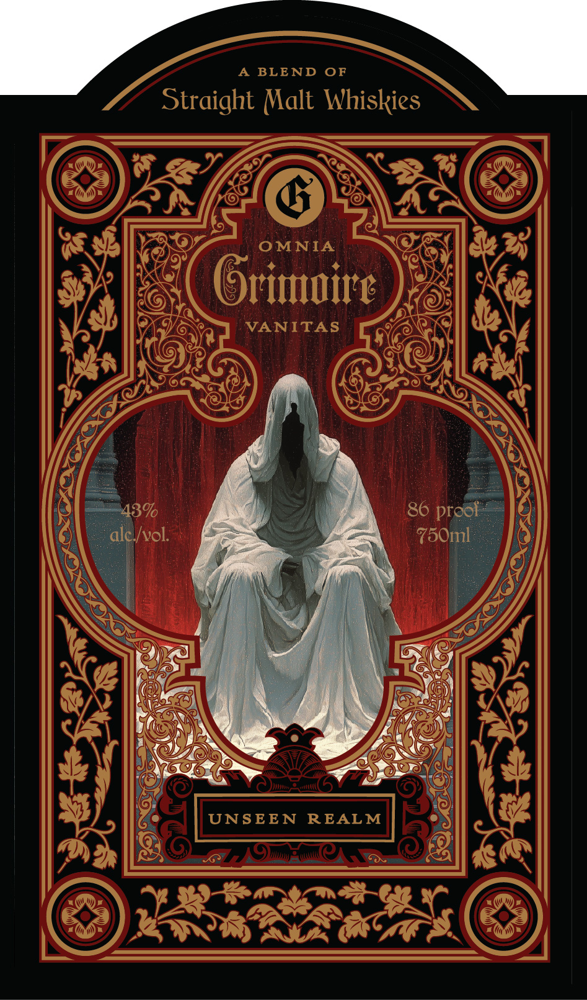
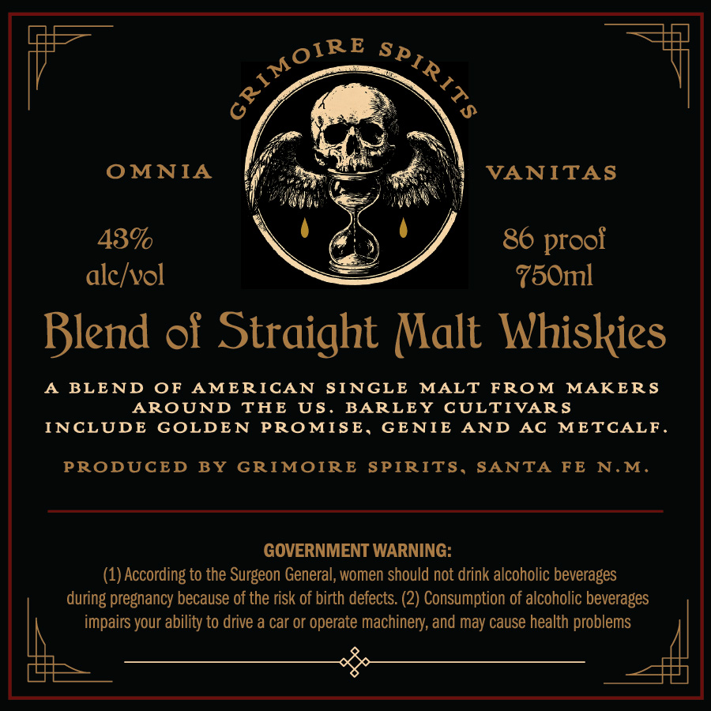

# TTB COLA Label Images - TTBID 26268001000127

**Brand Name:** UNSEEN REALM

**Issue Date:** 10/21/2026

**Origin Code:** 34

**Product Class/Type:** 129

**Source:** [TTB Public COLA Registry](https://ttbonline.gov/colasonline/viewColaDetails.do?action=publicFormDisplay&ttbid=26268001000127)

## Label Images

### Label 1

### Label 2

## Extracted Label Text

*Text extracted via OCR - may contain errors*

**Detected Proof:** 86

### Label 1

BLE ND
OF
Straight Malt Whiskies
OMNIA
Orimire
VANITAS
43%0
86 prool:
alci/vol:
750ml
UNSEEN
REAL M

### Label 2

OMNIA
VANITAS
43%
86
alclvol
750ml
Blend of Straight Malt Whiskies
BLEND
OF
AMERICAN
SINGLE
MALT
FROM
MAKER S
AROUND
THE
US.
BARLEY
CULTIVAR S
INCLUDE
GOLDE N
PROMISE,
GE NIE
AND
Ac
METCALF _
PRODUCED
BY
GRIMOIRE
SPIRITS,
SANTA
FE
N.M.
GOVERNMENT WARNING:
(1) According to the Surgeon General, women should not drink alcoholic beverages
during pregnancy because of the risk of birth defects: (2) Consumption of alcoholic beverages
impairs your ability to drive a car or operate machinery; and may cause health problems
GRIMOIR€
SPIRITS
proof
