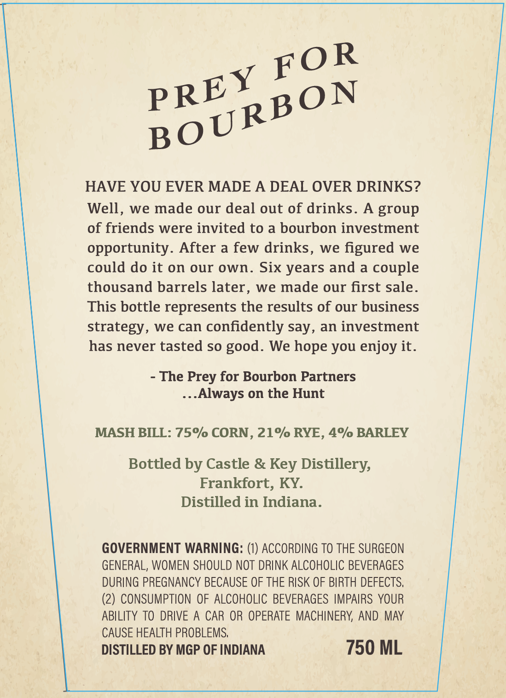
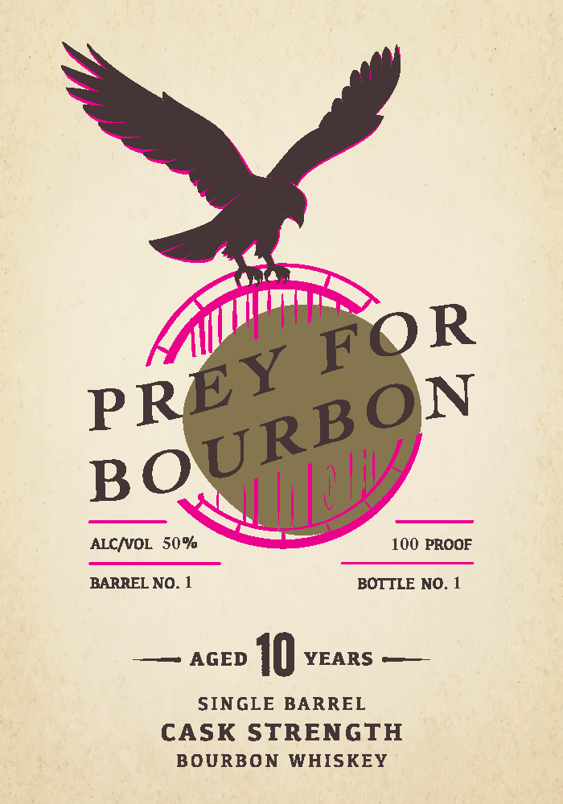

# TTB COLA Label Images - TTBID 26268001000298

**Brand Name:** PREY FOR BOURBON

**Issue Date:** 10/16/2026

**Origin Code:** 22

**Product Class/Type:** 141

**Source:** [TTB Public COLA Registry](https://ttbonline.gov/colasonline/viewColaDetails.do?action=publicFormDisplay&ttbid=26268001000298)

## Label Images

### Back Label

### Front Label

## Extracted Label Text

*Text extracted via OCR - may contain errors*

**Detected Proof:** 100
**Detected Age:** 10 Years

### Back Label

HAVE YOU EVER MADE A DEAL OVER DRINKS?
Well,
we made our deal out of drinks_
A group
of friends were invited to a bourbon investment
opportunity. After a few drinks, we figured we
could do it on our own.
Six years and a couple
thousand barrels later , we made our first sale_
This bottle represents the results of our business
strategy, we can confidently say, an investment
has never tasted so
We hope you enjoy it.
The Prey for Bourbon Partners
Always on the Hunt
MASH BILL: 75% CORN , 21% RYE , 4% BARLEY
Bottled by Castle &
Distillery;
Frankfort, KY:
Distilled in Indiana_
GOVERNMENT WARNING:
ACCORDING TO THE SURGEON
GENERAL, WOMEN SHOULD NOT DRINK ALCOHOLIC BEVERAGES
DURING PREGNANCY BECAUSE OF THE RISK OF BIRTH DEFECTS,
(2) CONSUMPTION OF ALCOHOLIC BEVERAGES IMPAIRS YOUR
ABILITY TO DRIVE
CAR OR OPERATE MACHINERV; AND MAY
CAUSE HEALTH PROBLEMS;
DISTILLED BY MGP OF INDIANA
750 ML
PREY FOR
BOURBON
good.
Key

### Front Label

ALCNOL 50%
100 PROOF
BARREL NO. 1
BOTTLE NO_
AGED
10
YEARS
SINGLE
BARREL
CASK
STRENGTH
BOURBON
WHISKEY
PREY FOR
BOURBON
Nil
