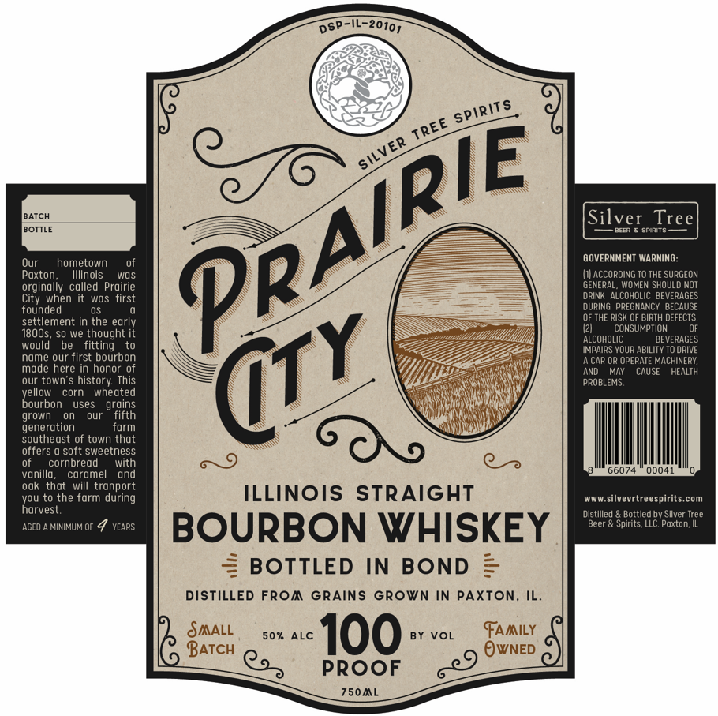
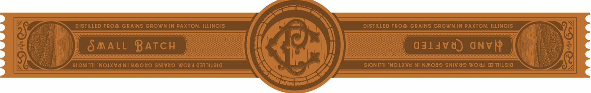

# TTB COLA Label Images - TTBID 26271001000042

**Brand Name:** PRAIRIE CITY

**Issue Date:** 10/20/2026

**Origin Code:** 04

**Product Class/Type:** 111

**Source:** [TTB Public COLA Registry](https://ttbonline.gov/colasonline/viewColaDetails.do?action=publicFormDisplay&ttbid=26271001000042)

## Label Images

### Front Label

### Label 2

## Extracted Label Text

*Text extracted via OCR - may contain errors*

**Detected Proof:** 100

### Front Label

DsP-IL-20101
BATCH
Silver
Tree
BOTTLE
BEC
spirite
Our
hometown
GOVERNMENT WARNING
Poxton
Illinois
wOs
ACCORDING TO THE SURGEON
orginally called Prairie
GENERAL. WOMEN SHOULD NOT
City when
wos  first
DRINK ALCOHOLIC BEVERAGES
founded
DUPIng PREGNANCY BECAUSE
settlement in the early
OF THE PISK OF BIRTH DEFECTS,
CONSUMPTION
1800s
SO we thought it
ALCOHOLIC
BEVERAGES
would
fitting
IMPAIRS YOUR ABILITY TO ORIVE
name our first bourbon
CAR OP OPERATE MACHINERY;
made here in nonor 0f
AND
MAY
CAUSE
HEALTH
our town"
history: This
PROBLEMS
vellow
corn
whedted
bourbon
uses
grains
grown
our
fifth
generation
form
southeast of town that
offers
soft sweetness
9
cornbread
with
66074
00041
vunillo ,
caromel
und
that
will tranport
howvesth
to the torm during
ILLINOIS
STRAiGHT
silvevrtreespirits com
Distilled
Bottled bv Silver Tree
AGED
MINIMUM OF
VEARS
BOURBON WHISKEY
Beer
Spirits, LLC Paxton, IL
BOTTLED IN
BOND
=
DISTiLLED From Grains Grown in PAXTON,
IL.
SAALL
50%
ALC
100
BY VOL
FAAILY
BATCH
OWNED
Qo_
PROOF
750AL
spirits
TREE
PRAIRIE
SILVER
@TY
ook

### Label 2

DISTILLED FROM GRAINS GROWN IN PAXTON; ILLINOIS
DISTILLED From GRAINS GROWN IN PAXTON: ILLINOIS
SAALL BATCH
OJ1JVd) aNVM
SI ONI 77I
NOLXVd Ninmoj) SNiVj) wodJ 0377i1SI0
SIONITII "NOLXVd NI Naods SNIV d9 wod]
03 711s10
