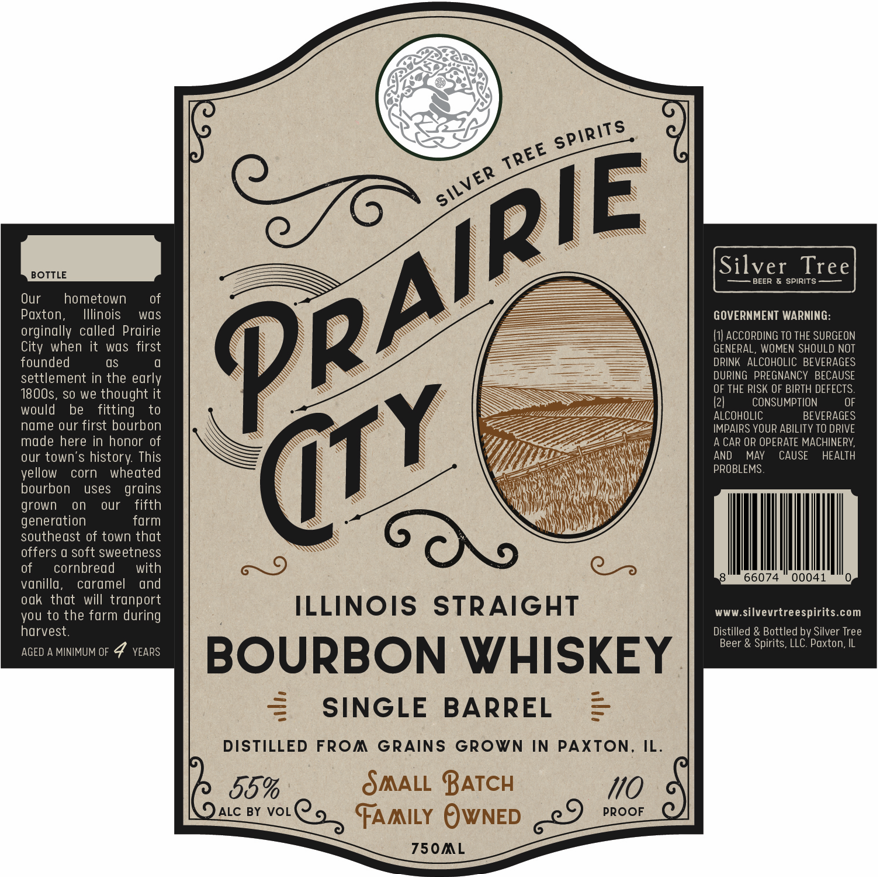
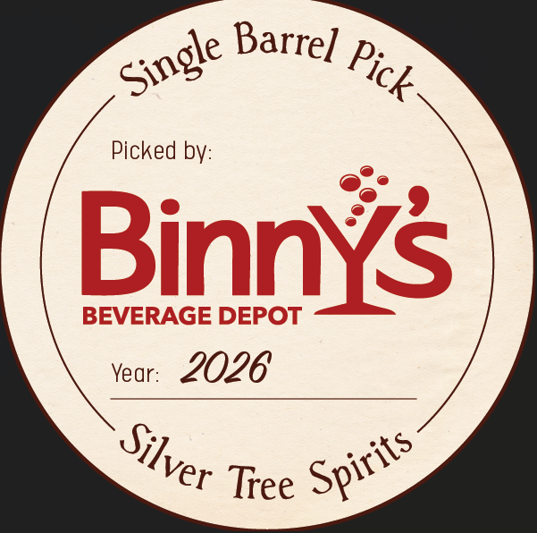

# TTB COLA Label Images - TTBID 26271001000043

**Brand Name:** PRAIRIE CITY

**Issue Date:** 10/16/2026

**Origin Code:** 04

**Product Class/Type:** 101

**Source:** [TTB Public COLA Registry](https://ttbonline.gov/colasonline/viewColaDetails.do?action=publicFormDisplay&ttbid=26271001000043)

## Label Images

### Front Label

### Label 2

### Label 3

## Extracted Label Text

*Text extracted via OCR - may contain errors*

**Detected Proof:** 110

### Front Label

Silver
Tree
BOUILE
SpipI
Our
hometown
Paxton
Illinois
Wos
GOVERMMENT WARNING:
orginally called Proirie
ACCORDING T0 THE SURGEON
when It
wOs
tirst
GENERAL, WOMEN SHOULD NoT
founded
DRINK  ALCOHOLIC BEVERAGES
settlement in the early
DUrIng PREGNANCY BECAUSE
1800s
SO we thought
OF THE RISK OF BIRTH DEFECTS:
CONSUMPTION
fitting
AlcohOLIC
BEVERAGES
name our first bourbon
IMPAIRS YOUR ABILITY TO DRIVE
made here in honor 0f
CAP OR OPERATE MACHINERY;
our town's history: This
AND
MAY
CAUSE
HEALTH
vellow
corn
whedted
PROBLEMS:
bourbon
uses
groins
grown
our
fifth
generation
torm
southeast of town thot
offers
soft sweetness
cornbread
with
66074
00041
vonillo,
coromel
ond
oak that will tronport
ILLINOIS STRAIGHT
vou t0 the farm during
WwW
silvevrtreespirits com
harvest:
Distilled
Bottled bv Silver Tree
Beer
Spirits LLC. Paxton IL
AGED
MINIMUM OF
YEARS
BOURBON WHISKEY
SINGLE
BARREL
DISTILLED FRom GRAinS GRown In PAXTON_
IL_
55%
SAALL BATCH
110
ALC BY
VOL
FAAILY OwNED
PROOF
750mL
spirits
TREE
PRAIRIE
SILVER
City
@TY
would

### Label 2

DISTILLED FROM GRAINS GROWN IN PAXTON; ILLINOIS
DISTILLED From GRAINS GROWN IN PAXTON: ILLINOIS
SAALL BATCH
OJ1JVd) aNVM
SI ONI 77I
NOLXVd Ninmoj) SNiVj) wodJ 0377i1SI0
SIONITII "NOLXVd NI Naods SNIV d9 wod]
03 711s10

### Label 3

Barrel
Picked bV:
Binnys
BEVERAGE DEPOT
Year:
2026
Tree
Single
Pick-
Silver
Spirits -
