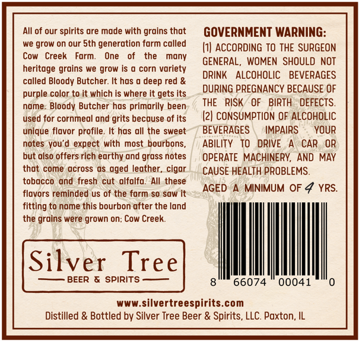
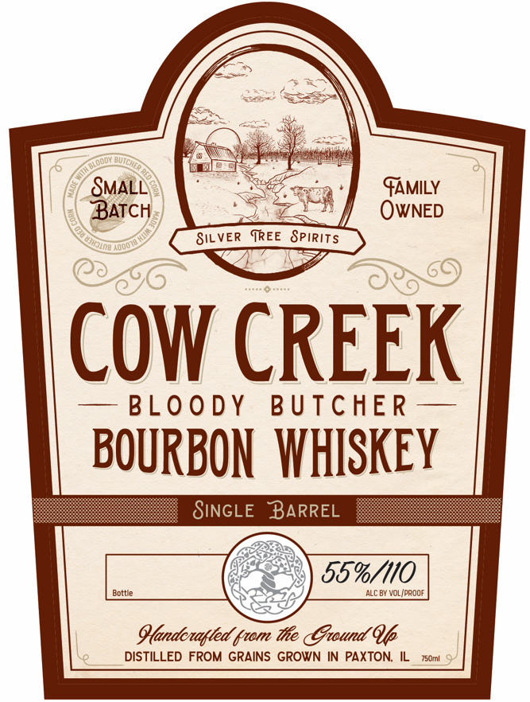
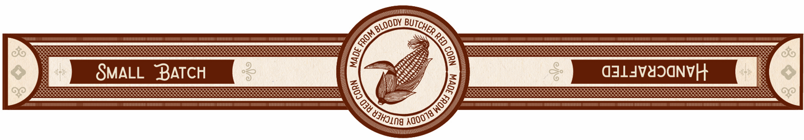

# TTB COLA Label Images - TTBID 26271001000051

**Brand Name:** COW CREEK

**Issue Date:** 10/22/2026

**Origin Code:** 04

**Product Class/Type:** 141

**Source:** [TTB Public COLA Registry](https://ttbonline.gov/colasonline/viewColaDetails.do?action=publicFormDisplay&ttbid=26271001000051)

## Label Images

### Back Label

### Front Label

### Label 2

### Label 3

## Extracted Label Text

*Text extracted via OCR - may contain errors*

### Back Label

All of our spirits are made with grains that
GOVERNMENT WARNING:
we
grow on our Sth generation farm called
I1| ACCORDING To THE SURGEON
Cow
Creek
Form
One
the
Mony
GENERAL, WOMEN SHOULD NOT
heritage grains we grow Is 0 corn variety
DRINK
ALCOHOLIC
BEVERAGES
called Bloody Butcher: It has
deep red &
purple color to it which is where it gets Its
DURING PREGNANCY BECAUSE OF
name
Bloody Butcher has primarily been
RISK
OF
BIRTH
DEFECTS.
used for cornmeal and
because of Its
(2| CONSUMPTION OF ALCOHOLIC
unique flavor profile. It has all the sweet
BEVERAGES
IMPAIRS
YOUR
notes you'd
expect with most bourbons;
ABILITY
TO   DRIVE
CAR
OR
but olso offers rich earthy and grass notes
OPERATE MACHINERY, AND MAY
thot come across
aged leather_
cigar
CAUSE HEALTH PROBLEMS.
tobacco
ond
fresh cut alfalfo
AIlthese
AGED
MINIMUM OF
YRS.
flavors reminded us of the farm so sow
fitting to name this bourbon after the land
the grains were grown on; Cow Creek
Silver Tree
BEER & SPIRITS
66074
00041
www.silvertreespirits com
Distilled & Bottled by Silver Tree Beer & Spirits, LLC. Paxton; IL
THE
grits

### Front Label

SMALL
FAMILY
BATCH
OwNED
SIL VER
TREE SpiRits
odo
COW CREEK
BLO 0 DY
B UTCHER
BOURBON   WHISKEY
SiNGLE
BARREL
55%/110
Bottle
ALc By VOLIpaoof
Gandenagted Gtom Te Gtound Qp
DISTILLED FROM GRAINS GROWN IN PAXTON;
750ml

### Label 2

Barrel
Picked bV:
Binnys
BEVERAGE DEPOT
Year:
2026
Tree
Single
Pick-
Silver
Spirits -

### Label 3

2
e
SMALL
BATCH
a3LJV43ONVH
GY0
BLOODY
BUTCHER F
FROME
Aqoo7awod)
81
{UJHJin8 '
