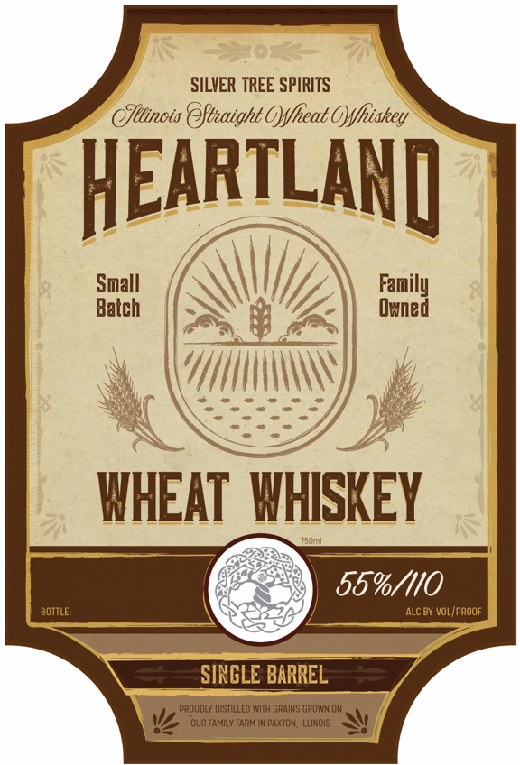
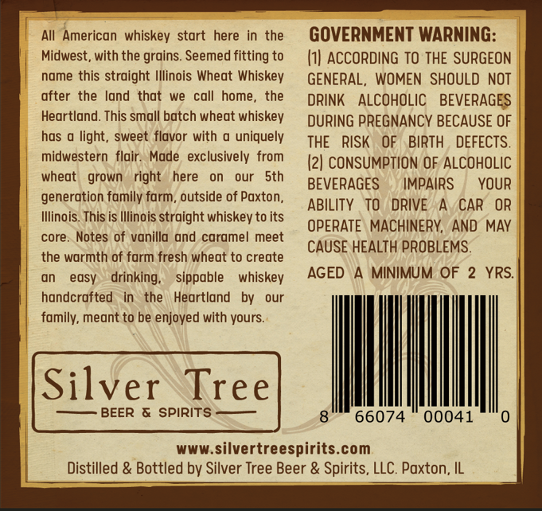
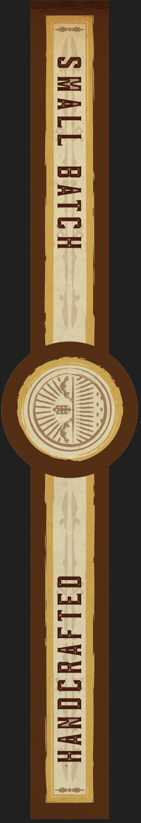

# TTB COLA Label Images - TTBID 26271001000056

**Brand Name:** HEARTLAND

**Issue Date:** 10/20/2026

**Origin Code:** 04

**Product Class/Type:** 140

**Source:** [TTB Public COLA Registry](https://ttbonline.gov/colasonline/viewColaDetails.do?action=publicFormDisplay&ttbid=26271001000056)

## Label Images

### Front Label

### Label 2

### Label 3

### Label 4

## Extracted Label Text

*Text extracted via OCR - may contain errors*

*1 image(s) excluded: text did not meet readability threshold*

**Detected Age:** 2 Years

### Front Label

SILVER TREE SPIRITS
eJttinots @ftuaight OYfheat OYfhiskey
HEARTLANQ
Small
Family
Balch
Owned
WHEAT   WHISKEY
559/110
BOTTLE:
ALC BY VOL (PROor
SINGLE BARREL
PROUDLY DISTILLEO With GRAINS GROWN OM
QUR FAMILY FARME
PAXTON, IlLINOIS

### Label 2

All  American whiskey start
here  in the
GOVERNMENT WARNING:
Midwest, with the grains. Seemed fitting to
h| ACCORDING To THE SURGEON
name this straight Illinois Wheat Whiskey
GENERAL, WOMEN SHOULD NOT
after the land that
we  call home_
the
DRINK
ALCOHOLIC
BEVERAGES
Heartland. This small batch wheat whiskey
DURING PREGNANCY BECAUSE OF
has @ light,
sweet flavor with
uniquely
THE
RISK
OF
BIRTH
DEFECTS.
midwestern flair. Made  exclusively from
(2| CONSUMPTION OF ALCOHOLIC
wheat
grown
right
here
our
Sth
BEVERAGES
IMPAIRS
YOUR
generation family farm, outside of Paxton,
ABILITY
TO
DRIVE
CAR
OR
Illinois This is Illinois straight whiskey to its
OPERATE MACHINERK,
AND MAY
core. Notes of vanilla and caramel meet
CAUSE HEALTH PROBLEMS.
the warmth of farm fresh wheat to create
on
easy
drinking;
sippable
whiskey
AGED
MINIMUM OF
2 YRS.
handcrafted   in
the
Heartland
by
our
family, meant to be enjoyed with yours
Silver
Tree
BEER & SPIRITS
66074
00041
www silvertreespirits com
Distilled & Bottled by Silver Tree Beer & Spirits, LLC. Paxton, IL

### Label 4

Barrel
Picked bV:
Binnys
BEVERAGE DEPOT
Year:
2026
Tree
Single
Pick-
Silver
Spirits -
