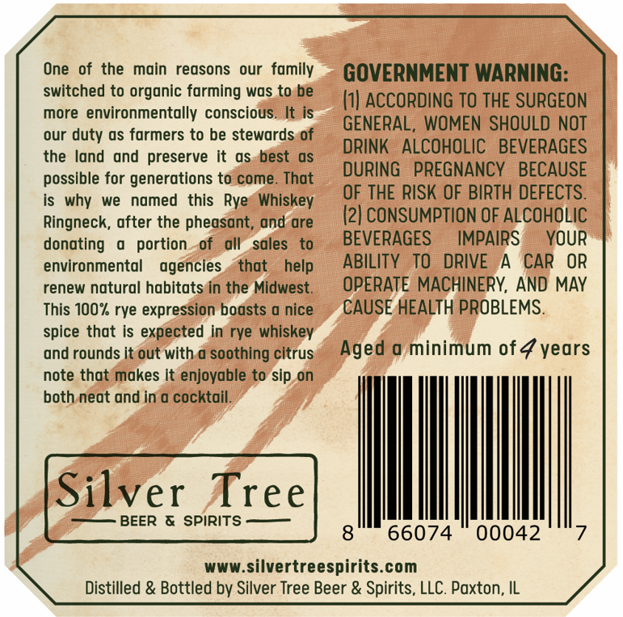
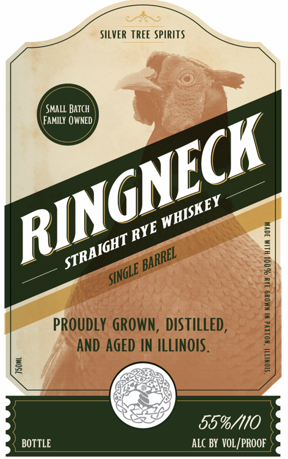
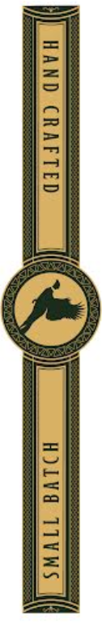

# TTB COLA Label Images - TTBID 26271001000061

**Brand Name:** RINGNECK

**Issue Date:** 10/22/2026

**Origin Code:** 04

**Product Class/Type:** 102

**Source:** [TTB Public COLA Registry](https://ttbonline.gov/colasonline/viewColaDetails.do?action=publicFormDisplay&ttbid=26271001000061)

## Label Images

### Back Label

### Front Label

### Label 2

### Label 3

## Extracted Label Text

*Text extracted via OCR - may contain errors*

*1 image(s) excluded: text did not meet readability threshold*

### Back Label

of the
main  reasons
our
family
GOVERNMENT WARNING:
switched to organic farming was to be
I1| AcCORdING TO THE SURGEON
more environmentally conscious. It is
GENERAL, WOMEN SHOULD NOT
our duty as farmers to be stewards of
land and
preserve It
as best
as
DRINK   ALCOHOLIC   BEVERAGES
possible for generations to come_
That
DURING
PREGNANCY
BECAUSE
is why
we
named
this Rye   Whiskey
OF THE RISK OF BIRTH DEFECTS.
Ringneck, after the pheasant, and are
(2| CONSUMPTION OF ALCOHOLIC
donating
portion
of
all   sales
to
BEVERAGES
IMPAIRS
YOUR
environmental
agencies
that
help
ABILITY   TO
DRIVE
CAR
OR
renew natural habitats In the Midwest
OPERATE MACHINERY, AND MAY
This 100% rye expression boasts @ nice
CAUSE HEALTH PROBLEMS.
spice that is expected in rye whiskey
and rounds it out with @ soothing citrus
Aged a minimum of4 years
note that makes It enjoyable to sip on
both neat and in 0 cocktail:
Silver Tree
BEER & SPIRITS
8
66074
00042
www.silvertreespirits com
Distilled & Bottled by Silver Tree Beer & Spirits, LLC. Paxton, IL
One
the

### Front Label

SILVER TREE SPIRITS
Small BATch
FAmily 0WNED
1
1
3
3
1
prOudLY GROWN , distIlleD,
1
AND AGED IN ILLINOIS .
1
1
55%/110
BOTTLE
ALC BY  VOL /PROOF
RINGNECK
WHISKEY
RYE _
STRAIGHT _
'BARREL
SINGLE [

### Label 3

Barrel
Picked bV:
Binnys
BEVERAGE DEPOT
Year:
2026
Tree
Single
Pick-
Silver
Spirits -
