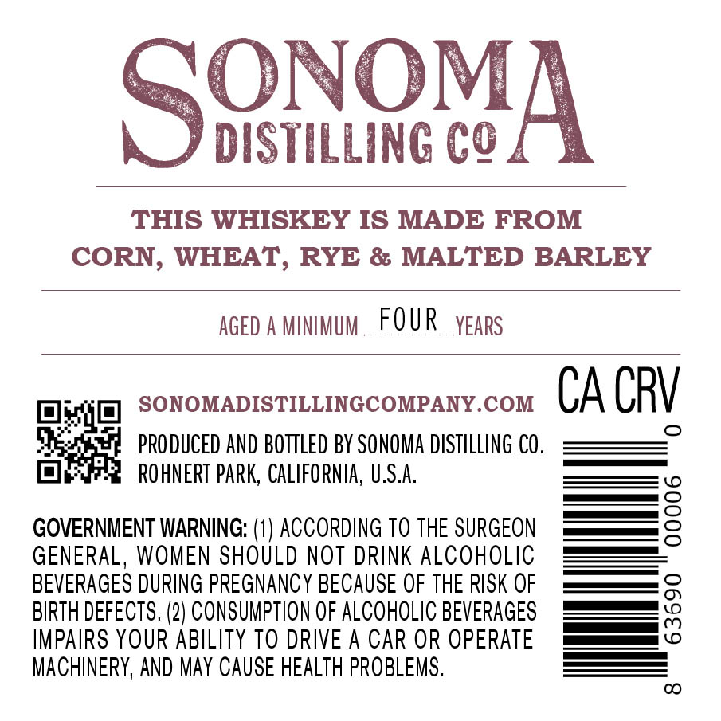
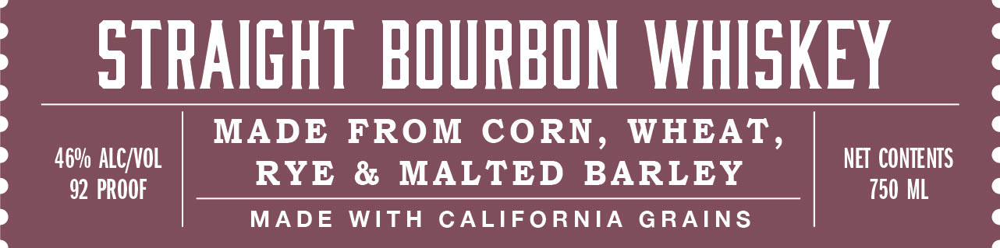
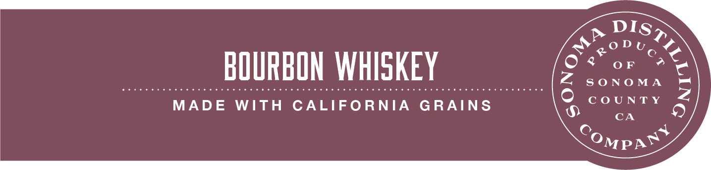

# TTB COLA Label Images - TTBID 26271001000144

**Brand Name:** SONOMA DISTILLING COMPANY

**Issue Date:** 10/28/2026

**Origin Code:** 01

**Product Class/Type:** 121

**Source:** [TTB Public COLA Registry](https://ttbonline.gov/colasonline/viewColaDetails.do?action=publicFormDisplay&ttbid=26271001000144)

## Label Images

### Back Label

### Front Label

### Label 3

## Extracted Label Text

*Text extracted via OCR - may contain errors*

**Detected Proof:** 92

### Back Label

SONOvA
DISTILLING CQ
THIS WHISKEY IS MADE FROM
CORN, WHEAT, RYE & MALTED BARLEY
AGED A MINMUM
FOUR
YEARS
SONOMADISTILLINGCOMPANY.COM
CA CRV
PRODUCED AND bottleD BY SONOMA DISTILLING CO .
ROhNERT PARK, CaLIFORNIA, U,S.A:
GOVERNIENT WARNING: (1) ACCORDING To THE SURGEON
2
GENERAL, WOMEN SHOULD NOT DRINK ALCOHOLIC
BEVERAGES DURING PREGNANCY BECAUSE OF THE RISK OF
BIRTH DEFECTS. (2) CONSUMPTION OF ALCOHOLIC BEVERAGES
8
IMPAIRS YOUR ABILITY TO DRIVE A CAR OR OPERATE
MACHINERY, AND May CAUSE HEALTH PROBLEMS .
CO

### Front Label

STRAIGHT BOURBON WHISKEY
MADE
FROM
CORN
WHEAT ,
46V ALC/VOL
NET CONTENTS
RYE
& MALTED
BARLEY
92 PROOF
750 ML
MADE
WITH
CALIFORNIA
GRAINS

### Label 3

LLU
one ’
BOURBON WHISKEY Son
MADE WITH CALIFORNIA GRAINS < CONNIE S
CA
Compas J
SS
