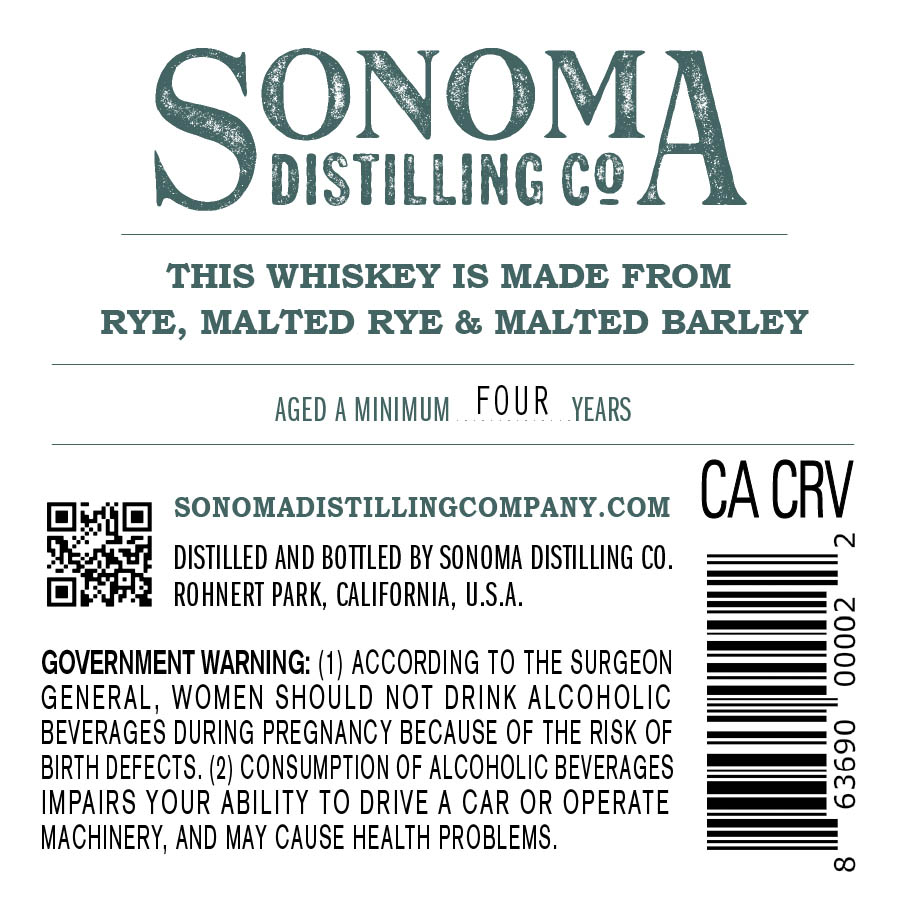
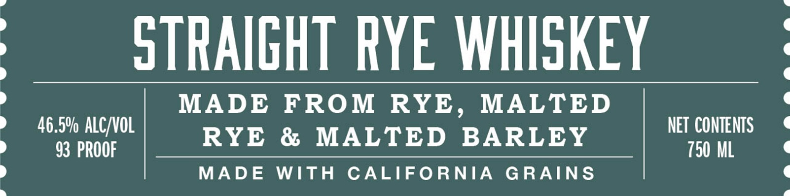
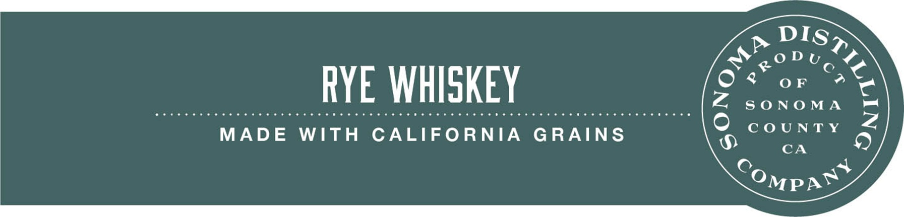

# TTB COLA Label Images - TTBID 26271001000163

**Brand Name:** SONOMA DISTILLING COMPANY

**Issue Date:** 10/27/2026

**Origin Code:** 01

**Product Class/Type:** 102

**Source:** [TTB Public COLA Registry](https://ttbonline.gov/colasonline/viewColaDetails.do?action=publicFormDisplay&ttbid=26271001000163)

## Label Images

### Back Label

### Front Label

### Label 3

## Extracted Label Text

*Text extracted via OCR - may contain errors*

**Detected Proof:** 93

### Back Label

SBiOMA
DISTILLING C?
THIS WHISKEY IS MADE FROM
RYE, MALTED RYE & MALTED BARLEY
AGED A MINMUM
FOUR
YEARS
SONOMADISTILLINGCOMPANY.COM
CA CRV
DISTILLED AND BOTTLED BY SONOMA DISTILLING CO .
ROhNERT PARK, CaLIFORNIA, U,S.A:
GOVERNIENT WARNING: (1) ACCORDING To THE SURGEON
2
GENERAL, WOMEN SHOULD NOT DRINK ALCOHOLIC
BEVERAGES DURING PREGNANCY BECAUSE OF THE RISK OF
BIRTH DEFECTS. (2) CONSUMPTION OF ALCOHOLIC BEVERAGES
8
IMPAIRS YOUR ABILITY TO DRIVE A CAR OR OPERATE
MACHINERY, AND May CAUSE HEALTH PROBLEMS .
CO

### Front Label

STRAIGHT RYE WHISKEY
MADE
FROM RYE,
MALTED
46.5' ALC VOL
NET CONTENTS
RYE
&
MALTED
BARLEY
93 PROOF
750 ML
MADE
WITH
CALIFORNIA
GRAINS

### Label 3

DIS

O%8 or 4

WoDu,

RYE WHISKEY

Z SONOMA

MADE WITH CALIFORNIA GRAINS

COUNTY

CA

Ompa™®

ay
