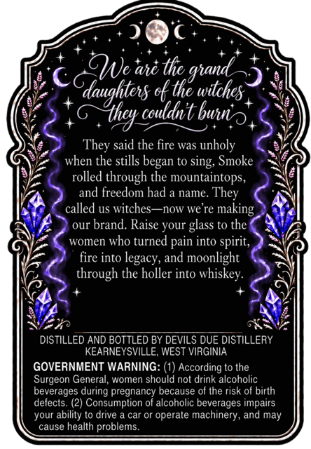
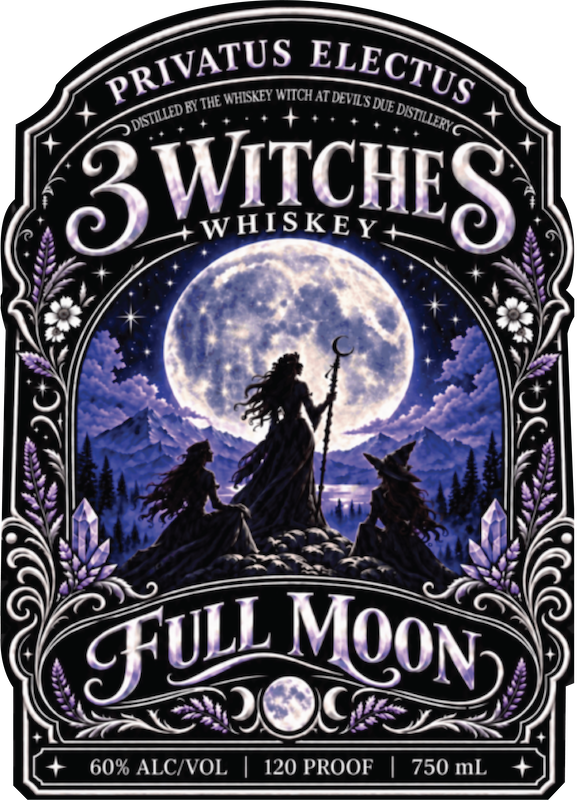

# TTB COLA Label Images - TTBID 26271001000332

**Brand Name:** DEVIL'S DUE DISTILLERY

**Fanciful Name:** 3 WITCHES WHISKEY FULL MOON

**Issue Date:** 10/09/2026

**Origin Code:** 47

**Product Class/Type:** 140

**Source:** [TTB Public COLA Registry](https://ttbonline.gov/colasonline/viewColaDetails.do?action=publicFormDisplay&ttbid=26271001000332)

## Label Images

### Back Label

### Front Label

## Extracted Label Text

*Text extracted via OCR - may contain errors*

**Detected Proof:** 120

### Back Label

QNe ae thc
ok the _
couldnt buno
They said the fire was unholy
when the stills began to sing, Smoke
rolled through the mountaintops,
and freedom had
name_
called us witches
nOw we re
our brand. Raise your glass to the
women
who turned pain into spirit,
fire into
and
moonlight
through the holler into whiskey:
7
DISTILLED AND BOTTLED BY DEVILS DUE DISTILLERY
KEARNEYSVILLE, WEST VIRGINIA
GOVERNMENT WARNING:
According to the
Surgeon General; women should not drink alcoholic
beverages during pregnancy because ol the risk of birth
defects
Consumption of alcoholic beverages impairs
your ability to drive
car or operate
machinery, and may
cause health problems
giand"
Gkaughtensc
witchcs
'Khey
They
making
legacy;

### Front Label

WHISKEY WITCH
DUE
3WiIcHEz
WHISKEY
8
60% ALCIVOL
120 PROOF
750 mL
PRIVATUS
ELECTUS
AT DEVILS
) DISTILLED BY THE
DISTILLERY
MOON)
SuLL
