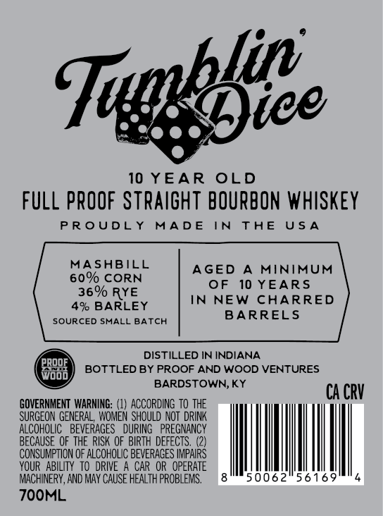
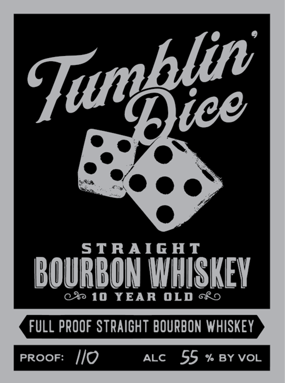

# TTB COLA Label Images - TTBID 26271001000458

**Brand Name:** TUMBLIN DICE

**Issue Date:** 10/15/2026

**Origin Code:** 22

**Product Class/Type:** 101

**Source:** [TTB Public COLA Registry](https://ttbonline.gov/colasonline/viewColaDetails.do?action=publicFormDisplay&ttbid=26271001000458)

## Label Images

### Back Label

### Front Label

## Extracted Label Text

*Text extracted via OCR - may contain errors*

**Detected Age:** 10 Years

### Back Label

10 YEAR
OLD
FuLL prOOF Straight BOURBON WhISKeY
PR OUDL Y
MA D E
IN
ThE
U5 A
MASABILL
A GED
MINIMUM
60% CORN
OF
10 YEARS
36% RYE
BARLEY
IN
NEW
CHARRED
4%
BARRELS
SOURCED SMALL BATCH
DISTILLED IN INDIANA
PrQQE
BOTTLED BY PROOF AND WOOD VENTURES
BARDSTOWN,KY
CA CRV
GOVERNMENT WARNING=
ACCORDING TO THE
SURGEON GENERAL  WOMEn SHOULD NOT  DRINK
ALCOHOLIC   BEVERAGES   DURING   PREGNANCY
BECAUSE  OF THE RISK OF BIRTH DEFECTS_
CONSUMPTLON OF ALCOHOLIC BEVERAGES IMPHIRS
YOUR   ABILITY TO DRIVE
CAR  OR OPERATE
MACHINERY, AND MAY CAUSE HEALTH PROBLEMS.
50062
56169
ZOOML
Tumbfiee
Vdod

### Front Label

STRAIGHT
BOURBON WHISKEY
0%0 10
YEAR
OLD G80
FULL proof STRAIGHT BOURBON WHISKEY
PROOF:
Ilo
ALC
55 % BY VOL
Tumblie |
