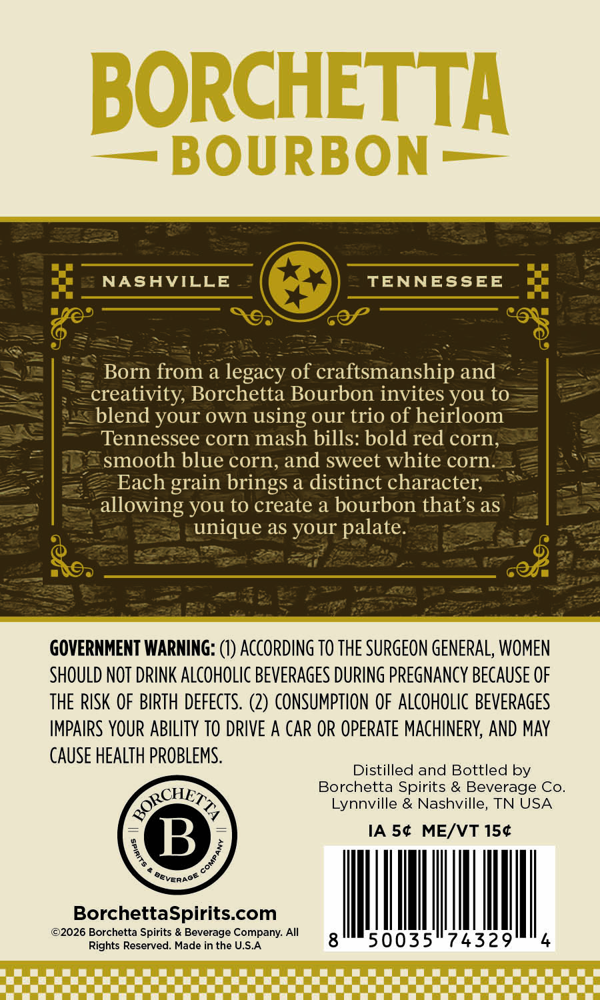
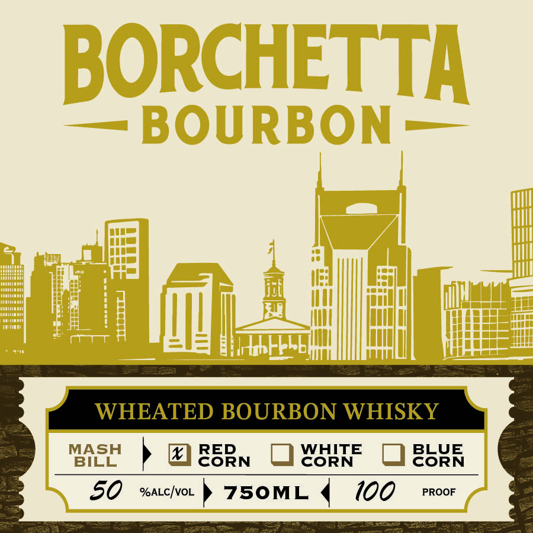

# TTB COLA Label Images - TTBID 26271001000583

**Brand Name:** BORCHETTA BOURBON

**Issue Date:** 10/09/2026

**Origin Code:** 43

**Product Class/Type:** 141

**Source:** [TTB Public COLA Registry](https://ttbonline.gov/colasonline/viewColaDetails.do?action=publicFormDisplay&ttbid=26271001000583)

## Label Images

### Back Label

### Label 1

## Extracted Label Text

*Text extracted via OCR - may contain errors*

**Detected Proof:** 100

### Back Label

BORCHETTA
BOURBON
NASAVILLE
TENNESSEE
%
Born from a legacy of craftsmanship and
creativity; Borchetta Bourbon invites you to
blend your own using our trio of heirloom
Tennessee corn mash bills: bold red corn;
smooth blue corn, and sweet white corn.
Each grain brings a distinct character;
allowing You to create a bourbon that s as
unique as your palate.
GOVERNMENT WARNING: (V) ACcORDING TO THE SURGEON GENERAL, WOMEN
SHOULD NOT DRINK ALCOHOLIC BEVERAGES DURING pREGNAncy BEcauSe OF
THE RISK OF BIRTH defects. (2) CONSUMPTION OF ALCOHOLIC BEVERAGES
IMPAIRS YOUR ABILITY TO DRIVE A CAR OR OPERATE MAcHINERV; AND MAy
CAUSE HEALTH PROBLEMS.
Distilled and Bottled by
Borchetta Spirits & Beverage Co_
Lynnville & Nashville, TN USA
B
IA 54 ME/VT 154
BorchettaSpiritscom
@2026 Borchetta Spirits & Beverage Company: All
Rights Reserved: Made in the U.S.A
RORCHE
TT

### Label 1

BORCHETTA
BOURBON
WHEATED BOURBON WHISKY
MASH
RED
WHITE
BLUE
BILL
CORN
CoRN
CORN
5o
%ALcIvoL
750ML
100
PROOF
