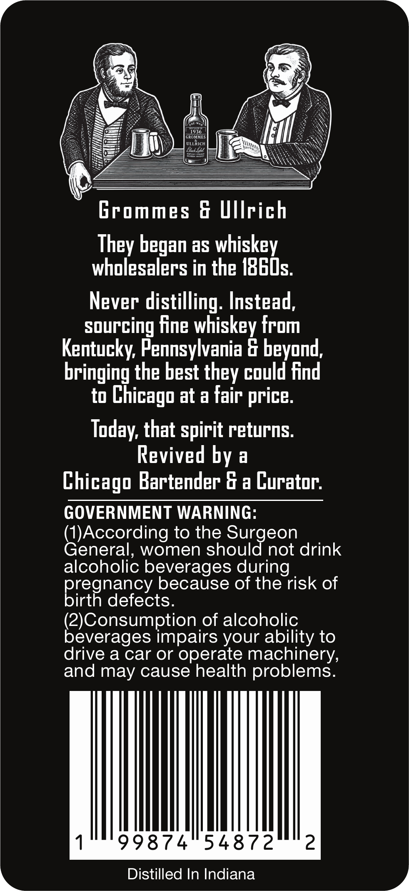
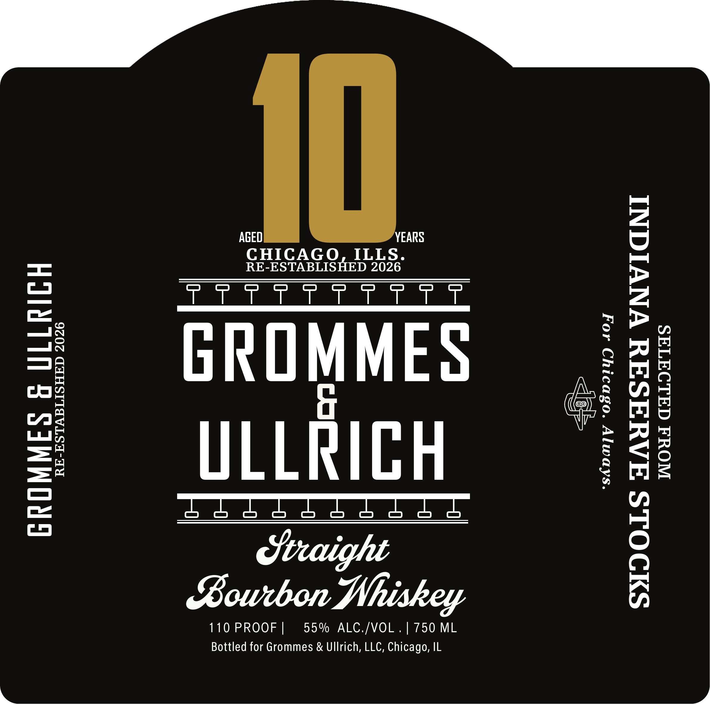

# TTB COLA Label Images - TTBID 26271001000768

**Brand Name:** GROMMES & ULLRICH

**Issue Date:** 10/27/2026

**Origin Code:** 04

**Product Class/Type:** 101

**Source:** [TTB Public COLA Registry](https://ttbonline.gov/colasonline/viewColaDetails.do?action=publicFormDisplay&ttbid=26271001000768)

## Label Images

### Back Label

### Front Label

### Label 2

## Extracted Label Text

*Text extracted via OCR - may contain errors*

*2 image(s) excluded: text did not meet readability threshold*

### Back Label

1936
GROMMES
ULLRICH
Rutix
Grommes & Ullrich
They began as whiskey
wholesalers in the I8GDs.
Never distilling: Instead,
sourcing fine whiskey from
Kentucky; Pennsylvania & beyond,
bringing the best they could Find
to
Chicago at a fair
Today; that spirit returns:
Revived by
a
Chicago Bartender G a Curator:
GOVERNMENT WARNING:
Generordingn
to the Surgeon
women should not drink
alcoholic beverages during
because of the risk of
pregnaetevtse
(2)Consumption of alcoholic
beverages impairs your ability to
drive a car or operate machinery,
and may cause health problems:
99874
54872
2
Distilled In Indiana
price
